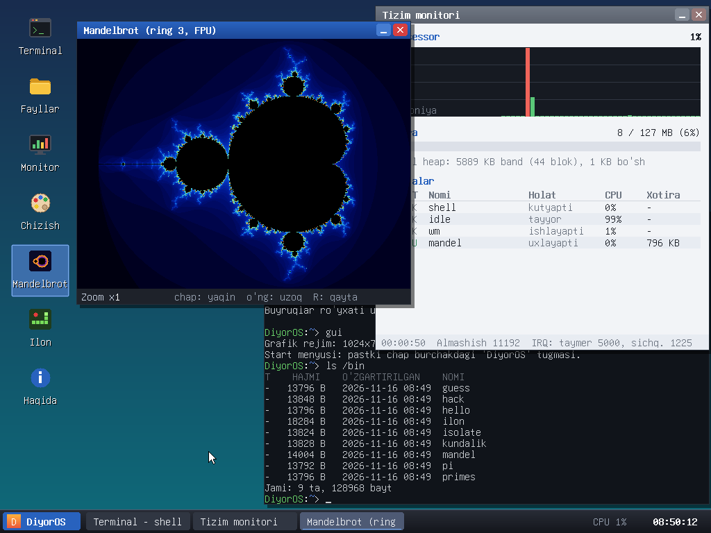

# DiyorOS v0.10

C va Assembly'da noldan yozilgan operatsion tizim. Arxitektura: x86, 32-bit protected mode.
Linux, Windows yoki boshqa OS kodidan foydalanilmagan: kompyuter yoqilgandan keyin ekranga chiqadigan
hamma narsani shu kod boshqaradi.



Nimalari bor:

- **Yuklanish**: Multiboot (QEMU `-kernel` yoki GRUB ISO), **BIOS va UEFI** (v0.9), GDT, IDT, PIC, TSS
- **Xotira**: fizik xotira menejeri (bitmap + frame hisoblagichlari), paging, har bir jarayonga alohida manzil
  maydoni, **copy-on-write** (v0.10), kernel heap
- **Jarayonlar**: preemptive Round-Robin scheduler, kernel oqimlari, ring 3 dagi dasturlar (ELF), 26 ta syscall,
  Unix jarayon modeli — **`fork`, `exec`, `wait`, `dup2`** (v0.10) va `spawn`, signal (Ctrl+C butun guruhga),
  har jarayonning o'z deskriptor jadvali va joriy papkasi; **user rejimidagi shell** (`qobiq`)
- **Sinxronizatsiya va IPC** (v0.8): mutex (deadlock aniqlash bilan), semafor, kutish navbatlari, kanallar
  (`ls | grep o | wc`), `>` `>>` `<` yo'naltirish; syscall'lar ichida ham uzilishlar yoqiq (preemptive kernel)
- **Fayl tizimlari**: VFS, ramfs, procfs (`/proc`), FAT32 (diskda, uzun nomlar bilan)
- **Drayverlar**: VGA matn rejimi va **grafik konsol** (UEFI framebuffer, v0.9), PS/2 klaviatura va sichqoncha,
  PIT taymer, CMOS soati, ATA (IDE) va **AHCI (SATA, DMA)** disklar, serial port
- **Ishonchlilik**: kernel panic (backtrace bilan), kernel jurnali (`dmesg`), stek va heap qo'riqchilari,
  faqat o'qiladigan kernel kodi, Double Fault uchun alohida stek, FPU kontekstini saqlash
- **Grafik interfeys** (v0.7): 1024x768, oyna menejeri va kompozitor, sichqoncha, vazifalar paneli,
  Start menyusi; Terminal, Fayllar, Tizim monitori, Chizish; ring 3 dagi grafik dasturlar (Mandelbrot, Ilon)
- **Shell**: 50 ta buyruq, qator tahriri, tarix, Tab bilan to'ldirish, matn muharriri

---

## 1. Mac'da ishga tushirish (M1/M2/M3)

Terminal'ni ochib, bir marta o'rnatasiz:

```bash
xcode-select --install          # make uchun (oldin o'rnatilgan bo'lsa, o'tkazib yuboring)
brew install i686-elf-gcc qemu  # x86 uchun cross-compiler va emulyator
```

Keyin loyiha papkasida:

```bash
make        # kernelni yig'adi -> build/diyoros.bin
make run    # QEMU oynasida OS ochiladi (birinchi marta disk.img ham yaratiladi)
```

Birinchi ishga tushirishda disk bo'sh bo'ladi: DiyorOS ichida `mkfs` deb yozib, `ha` bilan tasdiqlang.
Shundan keyin `/disk` dagi fayllar o'chirib-yoqqandan keyin ham saqlanadi.

`make run` paytida DiyorOS ekraniga chiqqan matn va kernel jurnali **Mac terminalida ham** ko'rinadi
(serial konsol). Kernel panic bo'lsa ham xabar terminalda qoladi — undan nusxa olish oson.

| Buyruq | Vazifasi |
|---|---|
| `make` | kernelni yig'ish |
| `make run` | QEMU'da ishga tushirish |
| `make debug` | QEMU'ni GDB kutish rejimida ishga tushirish (`i686-elf-gdb build/diyoros.bin -ex "target remote :1234"`) |
| `make iso` | GRUB orqali yuklanadigan `build/diyoros.iso` (UTM yoki haqiqiy kompyuter uchun) |
| `make run-ahci` | v0.9: zamonaviy mashina (Q35) — disk SATA (AHCI) kontrollerida |
| `make run-uefi` | v0.9: UEFI + Q35 + tayyor `diyoros.iso` (BIOS + UEFI) |
| `make newdisk` | yangi bo'sh `disk.img` |
| `make clean` | `build/` ni tozalash (`disk.img` saqlanadi) |

**Nega cross-compiler kerak?** Mac'ning kompilyatori macOS uchun (ARM, Mach-O format) kod
chiqaradi. Bizga esa hech qanday OS'ga bog'lanmagan x86 ELF kod kerak. `i686-elf-gcc` aynan
shuni qiladi.

**Nega QEMU?** M3 — ARM protsessor, x86 kodni to'g'ridan-to'g'ri bajara olmaydi. QEMU x86
kompyuterni dasturiy jihatdan emulyatsiya qiladi.

QEMU oynasiga bir marta bossangiz, sichqoncha va klaviatura OS'ga o'tadi. Sichqonchani Mac'ga
qaytarish: **Ctrl + Option + G**.

---

## 2. Ustozga ko'rsatish uchun demo ketma-ketligi

| Buyruq | Nimani ko'rsatadi |
|---|---|
| (yuklanish ekrani) | `[ OK ]` qatorlari — har bir tizim qismi ketma-ket ishga tushadi |
| `help` | Shell va buyruqlar jadvali |
| `mem`, `memmap` | Fizik xotira, paging, heap |
| `ps`, `spawn spinner`, `spawn busy` | Multitasking: vazifalar parallel ishlaydi, preemption |
| `ls /`, `cat /proc/meminfo`, `cat /proc/interrupts` | VFS, virtual fayllar |
| `edit /disk/salom.txt` | Matn muharriri, diskka yozish (qayta yoqqandan keyin ham turadi) |
| `hello`, `guess` | Ring 3 dagi dasturlar, syscall'lar |
| `hack 1` ... `hack 8` | Himoya: dastur kernelga tega olmaydi, faqat o'zi o'ladi |
| `pi &`, `pi &`, `pi` | Uchta dastur bir vaqtda suzuvchi nuqtali hisob qiladi (FPU konteksti) |
| `dmesg` | Kernel jurnali |
| `pagefault kod` | Kernel o'z kodiga yoza olmaydi (faqat o'qish uchun) |
| `crash stack` | Stek to'lib ketishi → Double Fault → toza *kernel panic* (qayta yuklanib ketmaydi) |
| `crash heap` | Buzilgan heap aniqlanadi |
| `pci` | PCI qurilmalari: videokarta, disk kontrolleri |
| `gui` | **Grafik rejim**: oynalar, sichqoncha, dasturlar — batafsil: [docs/v0.7-grafika.md](docs/v0.7-grafika.md) |
| `ls /bin \| grep o \| wc`, `sanoq 100 > /disk/son.txt`, `ota` | **Kanallar, yo'naltirish, spawn/wait** |
| `sinx poyga`, `sinx ishlab`, `sinx deadlock`, `sinx faylasuflar` | **Sinxronizatsiya**: race condition, producer-consumer, deadlock — batafsil: [docs/v0.8-sinxronizatsiya.md](docs/v0.8-sinxronizatsiya.md) |
| `hw` | Kompyuter haqida hisobot: protsessor, ekran (VGA yoki UEFI framebuffer), disk drayveri — [docs/v0.9-haqiqiy-kompyuter.md](docs/v0.9-haqiqiy-kompyuter.md) |
| `nusxa`, `mem` | **fork, copy-on-write, exec**: 1 MB fork da nusxalanmaydi, faqat yozilganda — [docs/v0.10-fork-exec.md](docs/v0.10-fork-exec.md) |
| `qobiq` → `primes 100 \| wc`, `sanoq 5 > /disk/a.txt`, `cd /bin` | **User rejimidagi shell**: fork + pipe + dup2 + exec |
| `fds`, `cat /proc/fds` | Deskriptor jadvallari: jarayon fd → ochiq fayl → fayl (uch qatlam) |
| `hack 9`, Ctrl+C | Fork bomb: kernel chegaralari, butun guruhni to'xtatish |

Har bir bosqichning batafsil demo ketma-ketligi va himoya savollari `docs/` papkasida.

**Shell'da qulayliklar:** ←/→ bilan qator ichida yurish, Home/End, Delete, Ctrl+A/E/K/U, Ctrl+L,
↑/↓ — tarix (32 ta), Tab — to'ldirish, Ctrl+C — dasturni to'xtatish, sichqoncha g'ildiragi yoki
Fn+↑/↓ — ekran tarixini varaqlash (500 qator). Bo'sh joyli nomlar: `"Mening faylim.txt"` yoki `Mening\ faylim.txt`.

---

## 3. Loyiha tuzilishi

```
DiyorOS/
├── Makefile              yig'ish qoidalari
├── linker.ld             kernelning xotirada joylashuvi (1 MB dan; kod va ma'lumot alohida)
├── grub.cfg              ISO uchun GRUB sozlamasi
├── include/              sarlavha (.h) fayllar
├── docs/                 har bir bosqich bo'yicha tushuntirish va himoya savollari
├── tools/mkfont.py       shrift faylini yaratish
├── src/
│   ├── boot/
│   │   ├── boot.s        Multiboot header, stek (qo'riqchi sahifa bilan), kernel_main ga o'tish
│   │   └── interrupts.s  GDT/IDT yuklash, uzilish "stub"lari, kontekst almashtirish
│   ├── kernel/
│   │   ├── kernel.c      asosiy funksiya: hamma qismni tartib bilan ishga tushiradi
│   │   ├── gdt.c         segmentlar (ring 0 / ring 3), TSS, Double Fault TSS
│   │   ├── idt.c         uzilishlar jadvali, PIC, soxta IRQ, exception'larni taqsimlash
│   │   ├── task.c        vazifalar, scheduler, fork/exec, signal, stek qo'riqchisi, FPU konteksti
│   │   ├── sync.c        kutish navbati, mutex (deadlock aniqlash), semafor (v0.8)
│   │   ├── process.c     ELF yuklovchi (spawn, exec), dastur xatolarini ushlash
│   │   ├── syscall.c     tizim chaqiruvlari, int 0x80
│   │   ├── panic.c       kernel panic, backtrace, Double Fault (v0.6.1)
│   │   ├── klog.c        kernel jurnali — dmesg (v0.6.1)
│   │   └── power.c       o'chirish va qayta yuklash
│   ├── drivers/
│   │   ├── vga.c         ekran (0xB8000), scrollback, kursor
│   │   ├── serial.c      serial port COM1 — konsol nusxasi (v0.6.1)
│   │   ├── pci.c         PCI shinasi: qurilmalarni topish (v0.7)
│   │   ├── fb.c          grafik rejim (Bochs VBE yoki bootloader framebuffer)
│   │   ├── fbcon.c       grafik konsol: 80x25 matnni piksellarga chizish (UEFI, v0.9)
│   │   ├── timer.c       PIT taymer, IRQ0
│   │   ├── keyboard.c    PS/2 klaviatura, IRQ1, ring buffer
│   │   ├── mouse.c       PS/2 sichqoncha: harakat, tugmalar, g'ildirak, IRQ12
│   │   ├── ata.c         ATA (IDE) qattiq disk, PIO
│   │   ├── ahci.c        AHCI (SATA) disk, DMA (v0.9)
│   │   ├── disk.c        blok qurilma qatlami: AHCI yoki ATA ni tanlaydi (v0.9)
│   │   └── rtc.c         CMOS real vaqt soati
│   ├── mm/
│   │   ├── pmm.c         fizik xotira menejeri (bitmap, frame hisoblagichlari)
│   │   ├── paging.c      virtual xotira, jarayonlarning sahifa jadvallari, copy-on-write
│   │   └── kheap.c       kmalloc / kfree
│   ├── fs/
│   │   ├── vfs.c         yo'llar, deskriptor jadvallari, joriy papka, mount
│   │   ├── ramfs.c       xotiradagi fayl tizimi
│   │   ├── procfs.c      /proc virtual fayllari
│   │   ├── fat32.c       FAT32: diskdagi fayl tizimi
│   │   ├── pipe.c        kanallar (pipe): 4 KB aylanma bufer (v0.8)
│   │   └── rootfs.c      yuklanishda papka va fayllarni yaratish
│   ├── gfx/              2D grafika (v0.7)
│   │   ├── gfx.c         sirtlar, to'rtburchak, chiziq, matn, BMP
│   │   └── font.c        8x16 shrift (tools/mkfont.py yaratadi)
│   ├── gui/              grafik interfeys (v0.7)
│   │   ├── wm.c          oyna menejeri, kompozitor, panel, menyu, oyna syscall lari
│   │   ├── terminal.c    shell uchun grafik terminal
│   │   ├── files.c       Fayllar
│   │   ├── viewer.c      matn va rasm ko'ruvchi
│   │   ├── monitor.c     Tizim monitori
│   │   ├── paint.c       Chizish
│   │   ├── apps.c        Haqida, dasturlarni ishga tushirish
│   │   └── widgets.c     tugmalar, ikonkalar
│   ├── lib/
│   │   ├── string.c      memset, memcpy, strcmp... (libc yo'q)
│   │   └── kprintf.c     printf'ning kernel varianti
│   └── shell/
│       ├── shell.c       buyruqlar qatori, qator tahriri, Tab
│       ├── cmd_memory.c  mem, alloc, heap, memtest, pagefault...
│       ├── cmd_process.c ps, fds, spawn, kill, sched
│       ├── cmd_fs.c      ls, cd, cat, cp, mv, rm, tree...
│       ├── cmd_disk.c    disk, mkfs, mount, umount
│       ├── cmd_sync.c    sinx: poyga, ishlab chiqaruvchi-iste'molchi, deadlock, faylasuflar (v0.8)
│       ├── cmd_hw.c      hw: kompyuter haqida hisobot (v0.9)
│       └── editor.c      matn muharriri (edit)
└── user/                 dasturlar — ring 3 da ishlaydi, /bin ga tushadi
    ├── crt0.s            dastur boshlanishi: main(argc, argv)
    ├── libc.c            printf, malloc, readline, syscall o'ramlari
    ├── ugfx.c            dasturlar uchun kichik grafika kutubxonasi (v0.7)
    ├── linker.ld         dasturlar 0x40000000 dan joylashadi
    ├── initrd.s          dasturlarni kernel ichiga joylash
    ├── hello.c guess.c primes.c hack.c isolate.c kundalik.c pi.c mandel.c ilon.c
    ├── wc.c grep.c head.c sanoq.c ota.c   (v0.8: kanallar va spawn/wait uchun)
    └── nusxa.c qobiq.c   (v0.10: fork/CoW/exec namoyishi va user rejimidagi shell)
```

---

## 4. Himoyada tushuntirish: OS qanday yuklanadi

1. **BIOS** kompyuterni tekshiradi va bootloader'ni ishga tushiradi.
2. **Bootloader** (QEMU yoki GRUB) kernel faylidan Multiboot header'ni (sehrli raqam `0x1BADB002`)
   topadi. So'ng kernelni 1 MB manzilga yuklaydi, protsessorni 32-bit protected mode'ga o'tkazadi
   va `_start` ga sakraydi.
3. **boot.s** stekni o'rnatadi va C'dagi `kernel_main` funksiyasini chaqiradi.
4. **kernel_main** quyidagilarni tartib bilan bajaradi (har biri oldingisiga tayanadi):
   - **Serial port, VGA** — xabar chiqara olish.
   - **GDT, TSS** — segmentlar va ruxsat darajalari: ring 0 kernel uchun, ring 3 dasturlar uchun.
   - **IDT, PIC** — 256 ta uzilish raqamining har biri uchun qaysi funksiya chaqirilishi.
   - **PMM → paging → heap** — xotiraning uch qatlami.
   - **FPU, ATA disk, fayl tizimlari** — `/`, `/proc`, `/bin`, `/disk`.
   - **Taymer, klaviatura, sichqoncha**, so'ng **`sti`** — uzilishlar yoqiladi.
   - **Scheduler** — shu oqim 1-vazifaga (shell) aylanadi, idle vazifasi yaratiladi.
5. **Shell** buyruqlarni o'qiydi, tahlil qiladi va bajaradi.

### Uzilish qanday ishlaydi (masalan, tugma bosilganda)

```
Klaviatura → PIC → protsessor → IDT[33] → isr33 (asm) → isr_common (registrlarni saqlaydi)
→ interrupt_handler (C) → keyboard_handler → belgini buferga yozadi
→ PIC'ga EOI ("tugatdim") yuboriladi → scheduler: boshqa vazifaga o'tish kerakmi? → iret
```

Shell `keyboard_getchar()` orqali bufferdan o'qiydi. Bu **producer–consumer** modeli: uzilish
ma'lumotni yozadi, shell uni o'qiydi. Bufer bo'sh bo'lsa, shell BLOCKED holatga o'tadi va
protsessor boshqa vazifalarga beriladi.

### Umumiy savollar

- **Nega libc (printf, malloc) ishlatmadingiz?** Ular OS ustida ishlaydi. Kernel ichida OS yo'q,
  shuning uchun `string.c` va `kprintf.c` ni o'zimiz yozdik. Dasturlar uchun esa alohida kichik
  libc bor (`user/libc.c`) — u syscall'lar orqali kernelga murojaat qiladi.
- **Exception va IRQ farqi?** Exception protsessorning o'zidan keladi (0 ga bo'lish, Page Fault).
  IRQ tashqi qurilmadan keladi (taymer, klaviatura).
- **Kernel xatosi va dastur xatosi farqi?** Dastur (ring 3) xato qilsa, faqat o'sha jarayon
  o'ldiriladi ("Segmentation fault"). Kernelning o'zi xato qilsa — *kernel panic*: tizim to'xtaydi,
  chunki buzilgan kernel bilan davom etish ma'lumotlarni yo'qotishi mumkin.

Har bir bosqichga oid savollar: `docs/v0.2-xotira.md` ... `docs/v0.10-fork-exec.md`.
Ustozga ko'rsatish uchun qisqa reja va eng ehtimoliy savollar: [docs/ustozga-korsatish.md](docs/ustozga-korsatish.md).

---

## 5. Bosqichlar

| Bosqich | Nima qo'shildi | OS nazariyasidagi mavzu |
|---|---|---|
| **v0.1** ✅ | boot, GDT, IDT, taymer, klaviatura, shell | Uzilishlar, drayverlar |
| **v0.2** ✅ | Fizik xotira menejeri, **paging**, `kmalloc`/`kfree` — [batafsil](docs/v0.2-xotira.md) | Xotirani boshqarish |
| **v0.3** ✅ | **Multitasking**: kontekst almashtirish, Round-Robin — [batafsil](docs/v0.3-jarayonlar.md) | Jarayonlar, rejalashtirish |
| **v0.4** ✅ | VFS, ramfs, procfs, matn muharriri — [batafsil](docs/v0.4-fayl-tizimi.md) | Fayl tizimlari |
| **v0.5** ✅ | User mode (ring 3), syscall, ELF, libc — [batafsil](docs/v0.5-user-mode.md) | Himoya, tizim chaqiruvlari |
| **v0.6** ✅ | ATA disk, FAT32, `/disk` — [batafsil](docs/v0.6-disk-fat32.md) | Kiritish-chiqarish, disklar |
| **v0.6.1** ✅ | Kod tekshiruvi: 20+ xato tuzatildi; panic, jurnal, serial, FPU, himoyalar — [batafsil](docs/v0.6.1-mustahkamlash.md) | Ishonchlilik, race condition |
| **v0.7** ✅ | Grafik rejim, PCI, oyna menejeri, sichqoncha, 7 ta grafik dastur, oyna syscall lari — [batafsil](docs/v0.7-grafika.md) | Grafik quyi tizim, I/O |
| **v0.8** ✅ | Mutex, semafor, deadlock aniqlash, kanallar, yo'naltirish, `spawn`/`wait`, signallar, preemptive kernel — [batafsil](docs/v0.8-sinxronizatsiya.md) | Sinxronizatsiya, IPC |
| **v0.9** ✅ | UEFI, grafik konsol, AHCI (SATA, DMA), ichki diskni himoyalash, `hw` — [batafsil](docs/v0.9-haqiqiy-kompyuter.md) | Kiritish-chiqarish, yuklanish |
| **v0.10** ✅ | `fork` + copy-on-write, `exec`, `dup2`, har jarayonning o'z fd jadvali va papkasi, user rejimidagi shell — [batafsil](docs/v0.10-fork-exec.md) | Jarayonlar, virtual xotira |
| v0.11 | Avtomatik testlar, o'lchovlar, scheduler algoritmlarini taqqoslash | Tadqiqot |
| v1.0 | Haqiqiy kompyuterda sinov natijalari, diplom matni, taqdimot | — |

---

## 6. UTM yoki haqiqiy kompyuterda yuklash

`make iso` buyrug'i GRUB orqali yuklanadigan `build/diyoros.iso` faylini yaratadi (`grub-mkrescue`
va `xorriso` kerak; Linux'da o'rnatish osonroq).

v0.9 dan boshlab ISO **BIOS va UEFI** da yuklanadi (Linux'da yig'ilgan tayyor `diyoros.iso` —
loyiha ildizida). Batafsil, qadamma-qadam: [docs/v0.9-haqiqiy-kompyuter.md](docs/v0.9-haqiqiy-kompyuter.md).

- **UTM**: Emulate → Other → ISO sifatida `diyoros.iso`, x86_64, 512 MB RAM, 1 GB disk; USB'ni
  o'chiring (yoki "Force PS/2 controller"). Birinchi yuklanishda `mkfs`.
- **Haqiqiy kompyuter**: ISO'ni balenaEtcher bilan USB'ga yozing; BIOS'da Secure Boot — o'chiq,
  SATA — AHCI. Kompyuterning ichki diski **himoyalangan**: DiyorOS uni ulamaydi va formatlamaydi.
  Mac'ning o'zida yuklanmaydi (ARM protsessor).
