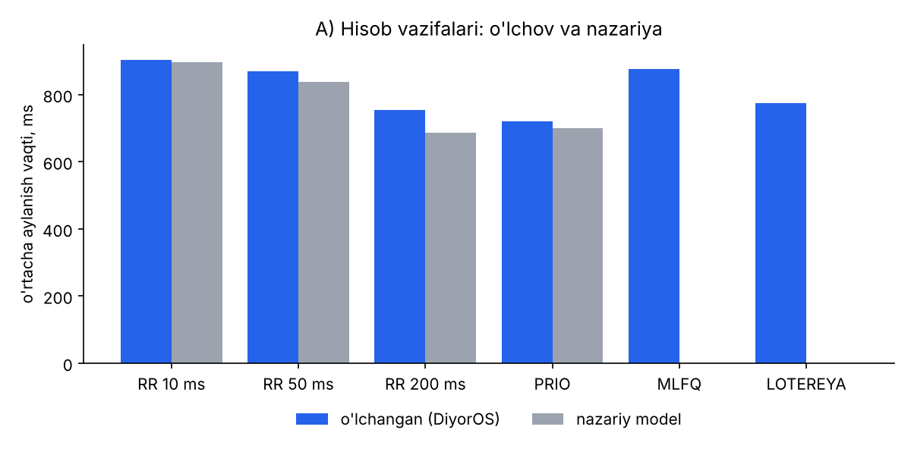
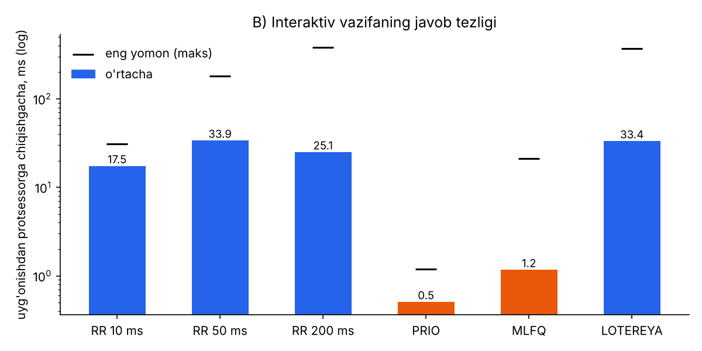
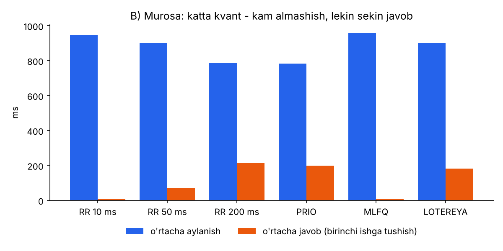
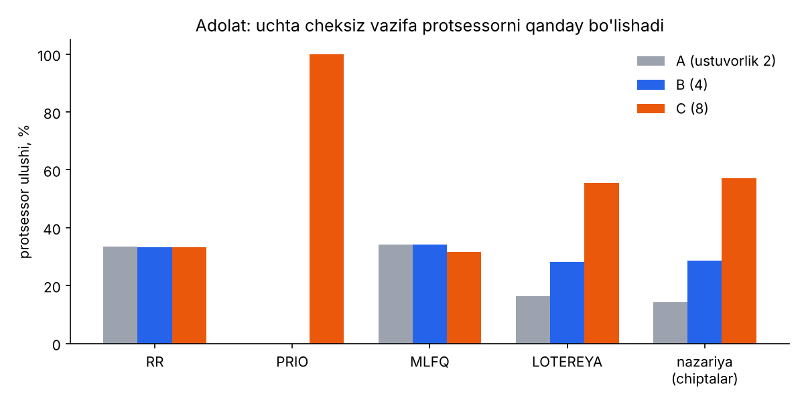

# v0.11 — Tadqiqot: rejalashtirish algoritmlari, o'lchovlar va avtomatik testlar

Bu bosqich diplom ishining **tadqiqot qismi**. Savol: *bitta protsessorli OS da qaysi
rejalashtirish algoritmi foydalanuvchiga eng yaxshi natija beradi va bu qanchalik farq qiladi?*
Javob uchun DiyorOS ga to'rtta algoritm, aniq vaqt o'lchash va takrorlanadigan tajribalar
qo'shildi. Natijalar nazariy model bilan tekshirildi.

| Nima | Qayerda |
|---|---|
| 4 ta algoritm: RR, PRIO, MLFQ, lotereya; ish vaqtida almashtiriladi | `task.c`, `reja` buyrug'i |
| Ustuvorlik | `ustuvor PID N` |
| Aniq vaqt: protsessor taktlari (TSC), mikrosekund aniqlikda | `tsc.h`, `timer.c` |
| Har vazifa uchun o'lchovlar: kutish, javob, uyg'onish kechikishi, aniq CPU vaqti | `task_t` |
| Tajribalar: `reja taqqos` (A va B qism), `reja ulush` | `schedbench.c` |
| Mikro-o'lchovlar: syscall, fork, CoW, exec, pipe, fayllar | `user/olchov.c` |
| Kernel testlari (10 guruh, 73 tekshiruv) + user testlari (33 tekshiruv) | `selftest.c`, `user/sinov.c` |
| `make test`, `make bench` — ekransiz, QEMU o'zi o'chadi | `Makefile` |
| Nazariy model va grafiklar | `tools/sched_sim.py`, `tools/grafik.py` |

**Asosiy natijalar:**

1. O'lchangan qiymatlar nazariy model bilan **0,6–4%** farq qiladi (RR 10/50 ms, PRIO) —
   scheduler algoritmni to'g'ri bajaradi, o'lchov usuli ishonchli.
2. **MLFQ** interaktiv vazifaga o'rtacha **1,2 ms** da javob beradi. RR da bu 17–34 ms
   (15–30 baravar sekin), o'rtacha aylanish vaqti esa deyarli bir xil.
3. **PRIO** eng tez javob beradi (0,5 ms), lekin past ustuvorlikli vazifani butunlay "och
   qoldiradi" (ulush tajribasida 0%).
4. **Lotereya** protsessorni chiptalar nisbatida bo'ladi (16/28/55%, nazariya 14/29/57%),
   lekin javob vaqti tasodifiy va katta (maks 370 ms).
5. Tadqiqot jarayonida RR dagi **xato topildi** va tuzatildi (4-bo'lim). Natijalarga
   asoslanib **standart algoritm MLFQ ga almashtirildi**.

Yangi kod: ~1 800 qator C (jami ~21 900, shrift faylisiz) va ~340 qator Python vositalari.

---

## 1. Sinab ko'rish

```
make test          # 106 ta tekshiruv, ~1 soniya; oxirida: SELFTEST: OK
make bench         # ~1 daqiqa: barcha tajribalar -> build/bench.log, build/bench.csv
python3 tools/grafik.py build/bench.csv     # grafiklar (matplotlib kerak)
python3 tools/sched_sim.py build/bench.csv  # nazariya va o'lchov yonma-yon
```

DiyorOS ichida:

| Buyruq | Nima |
|---|---|
| `reja` | joriy algoritm va har vazifa: ustuvorlik, MLFQ darajasi, CPU, kutgan vaqt, uyg'onish kechikishi |
| `reja rr 50`, `reja prio`, `reja mlfq`, `reja lotereya` | algoritmni almashtirish (darhol) |
| `reja taqqos [N]` | A va B tajribalari, N marta takror (~20 s) |
| `reja ulush` | protsessor ulushi tajribasi (~8 s) |
| `ustuvor PID N` | ustuvorlik: 1 (past) ... 10 (tizim); user dasturlar — 5 |
| `tekshir`, `tekshir -v` | kernelning o'z-o'zini tekshirishi |
| `olchov` | mikro-o'lchovlar (user dastur) |
| `sinov`, `sinov -v` | user rejimidagi syscall testlari |

---

## 2. Algoritmlar

Hamma algoritm bitta mexanizmni ishlatadi: tayyor vazifalar **FIFO navbatda** turadi (har
biriga navbatga turgan tartib raqami — `seq` beriladi), `pick_next` esa navbatdan kimni
olishni hal qiladi.

| Algoritm | Kimni tanlaydi | Kvant | Uyg'ongan vazifa joriysini to'xtatadimi |
|---|---|---|---|
| **RR** (Round-Robin) | navbatda eng oldingisi | sozlanadi (10–1000 ms, standart 50) | yo'q — navbat oxiriga turadi |
| **PRIO** | eng yuqori ustuvorlik; tenglar — FIFO | RR niki | ha, agar ustuvorligi yuqori bo'lsa |
| **MLFQ** | eng yuqori daraja; daraja ichida — FIFO | darajaga bog'liq: 10 / 20 / 40 ms | ha, agar darajasi yuqori bo'lsa |
| **Lotereya** | tasodifiy: ehtimol = chiptalar / jami | RR niki | yo'q |

### MLFQ qoidalari (Arpaci-Dusseau, OSTEP 8-bob)

1. Yangi vazifa eng yuqori darajada (0) boshlaydi.
2. Yuqoriroq darajadagi vazifa doim oldin ishlaydi.
3. Vazifa darajada **jami** belgilangan vaqtni ishlatsa (0-darajada 20 ms, 1-darajada 40 ms),
   pastga tushadi. "Jami" muhim: aks holda dastur kvant tugashidan sal oldin uxlab, abadiy
   yuqorida qolib ketardi (*gaming*).
4. Har 1 soniyada hamma vazifalar 0-darajaga ko'tariladi — pastdagilar och qolmaydi, tabiati
   o'zgargan vazifa (hisobdan interaktivga) yana yuqoriga chiqadi.

Natija: ko'p uxlaydigan (interaktiv) vazifalar yuqorida qoladi va tez javob beradi, hisob
vazifalari pastga tushib, katta kvant bilan kamroq almashadi. Algoritm vazifa haqida oldindan
hech narsa bilmaydi — uni **xatti-harakatidan** o'rganadi.

### Lotereya (Waldspurger va Weihl, 1994)

Har vazifada ustuvorligiga teng chipta (1–10). Har kvantda `[0, jami)` oralig'idan tasodifiy son
(xorshift32) tortiladi — u kimning chiptasiga tushsa, o'sha ishlaydi. Uzoq muddatda ulush
chiptalarga proporsional; qisqa muddatda — tasodifiy.

### Ustuvorliklar

Kernel oqimlari (shell, oyna menejeri, konsol) — 10, user dasturlar — 5, fork bolasi otaning
ustuvorligini oladi. `ustuvor` bilan o'zgartiriladi. PRIO va lotereyada ta'sir qiladi.

---

## 3. O'lchash usuli

### Aniq vaqt: TSC

Taymer (PIT) 100 Hz: eng kichik qadam 10 ms. Kontekst almashtirish bir necha mikrosekund — taymer
uni ko'rmaydi. Shuning uchun protsessorning takt hisoblagichi ishlatiladi: `rdtsc` buyrug'i
64 bitli sonni qaytaradi, u har taktda +1. Yuklanishda 50 ms (5 ta tik) ichida TSC qanchaga
o'sishi o'lchanadi — chastota (QEMU da ~2100 MHz).

Kernel `libgcc` siz yig'iladi — 64 bitli bo'lish (`__udivdi3`) yo'q. `udiv64` ikkita 32 bitli
`divl` buyrug'i bilan bo'ladi (ustunli bo'lish kabi).

### Har vazifa uchun nima yoziladi

| Maydon | Qachon | Nima uchun |
|---|---|---|
| `start_tsc`, `end_tsc` | yaratilganda, tugaganda | aylanish vaqti |
| `ready_since` | READY ga o'tganda | navbatda kutish |
| `ready_wait` | protsessorga chiqqanda: `+= hozir - ready_since` | jami kutish vaqti |
| `first_wait` | birinchi marta protsessorga chiqqanda | javob vaqti |
| `wake_lat_sum/max`, `wakeups` | uxlash yoki kutishdan keyin protsessorga chiqqanda | uyg'onish kechikishi |
| `run_cycles` | protsessordan tushganda: `+= hozir - run_since` | aniq CPU vaqti |

Hammasi kontekst almashtirish paytida (uzilishlar o'chiq) yoziladi — bir necha o'nlab takt.

### Ish yuklamasi

**A-qism (tekshiruv)** — faqat 4 ta hisob vazifasi, hammasi bir paytda keladi (bitta bo'linmas
qadamda yaratiladi):

| Vazifa | CPU vaqti | Ustuvorlik |
|---|---|---|
| qisqa | 95 ms | 5 |
| orta | 195 ms | 5 |
| uzun | 395 ms | 5 |
| fon | 795 ms | 2 |

Vazifa o'zining **aniq CPU vaqti** (`run_cycles`) belgilangan qiymatga yetguncha hisoblaydi.
Hajmlar kvantga karrali emas (95, emas 100) — 4-bo'limga qarang.

**B-qism (aralash)** — o'sha 4 ta + 2 ta interaktiv vazifa (ustuvorlik 8): 30 marta "20 ms
uxlash + 1 ms ish". Bu klaviatura yoki sichqonchaga javob beradigan dasturning modeli.

**Ulush** — uchta cheksiz hisob vazifasi (ustuvorlik 2, 4, 8) 2 soniya; kvant 10 ms.

Vazifalar **kernel oqimlari**: dastur yuklash va syscall xarajatlari aralashmaydi, faqat
scheduler qarori o'lchanadi. Har tajriba **3 marta** takrorlanadi; jadvallarda o'rtacha
qiymat, `tools/grafik.py` standart chetlanishni ham ko'rsatadi.

### Muhit

QEMU 8.2 (TCG — dasturiy emulyatsiya), `-M pc`, 128 MB, Linux host. Emulyatorda buyruqlar haqiqiy
protsessordagidan sekin va boshqacha nisbatda bajariladi, shuning uchun **mutlaq** qiymatlar
(mikrosekundlar) haqiqiy kompyuterga to'g'ridan-to'g'ri o'tmaydi. **Nisbiy** xulosalar (qaysi
algoritm qanchalik yaxshi) esa algoritmning o'ziga bog'liq va o'zgarmaydi. Haqiqiy kompyuterda
qayta o'lchash uchun: `make iso`, USB dan yuklash, `reja taqqos 3`.

Tajriba **matn rejimida** (`make bench`) o'tkaziladi. Grafik konsolda (UEFI, GRUB) `fbcon` oqimi
har 20 ms da ekranni chizadi — bu tajribaga qo'shimcha yuk: o'sha o'lchovda UEFI ostida RR 50
ning nazariyadan farqi +3,9% emas, +7,8% chiqdi. Aniq taqqoslash uchun fon yuklamasi bo'lmasligi
kerak — bu ham tajriba metodikasining bir qismi.

---

## 4. Tadqiqot topgan xato: RR haqiqiy navbat emas edi

Birinchi o'lchovda g'alati natija chiqdi: RR 50 ms da qisqa vazifa 1400 ms da tugadi, RR 10 ms
da esa 800 ms da — nazariyaga zid. Sabab ikkita edi:

1. **Uyg'onish joriy vazifani to'xtatardi.** v0.3 dan beri har qanday vazifa uyg'onganda
   (`task_unblock`) darhol qayta rejalashtirilardi va joriy vazifa kvantini yo'qotardi. Navbat
   jadval tartibida (FIFO emas) yurgani uchun boshqaruv ko'pincha uyg'ongan vazifaga emas,
   jadvaldagi keyingisiga o'tardi. Natijada interaktiv vazifalar har 20 ms da hisob
   vazifalarining kvantini "kesib" qo'yardi.
2. **Ish hajmi tick bilan sanalardi.** Vazifaning oxirgi tick i kvant tugashi bilan bir
   paytga to'g'ri kelsa, u "tugadim" deyishga ulgurmay navbatga qaytarilardi va natijaga
   butun bir aylanish qo'shilardi.

Tuzatish: haqiqiy FIFO navbat (`seq`), uyg'onish faqat muhimroq vazifa uchun to'xtatadi
(`preempts`), CPU vaqti TSC bilan (`run_cycles`), hajmlar kvantga karrali emas. Shundan keyin
o'lchov nazariyaga tushdi (5-bo'lim). Bu — o'lchovni nazariya bilan solishtirishning amaliy
foydasi: model bo'lmaganda xato "algoritm xususiyati" deb yozilib ketardi.

---

## 5. Natijalar

To'liq chiqish: [`docs/grafik/bench-natija.txt`](grafik/bench-natija.txt), xom ma'lumot:
[`docs/grafik/bench.csv`](grafik/bench.csv).

### A) Tekshiruv: o'lchov va nazariya

```
Algoritm  Kvant  Aylanish  Nazariya    Farq   Kutish   Javob   Alm.
RR           10       903       897   +0.6%      533      11    116
RR           50       870       837   +3.9%      500      71     28
RR          200       754       687   +9.7%      384     217     11
PRIO         50       720       700   +2.8%      350     205     16
MLFQ      10-40       877         -       -      507      12     47
LOTEREYA     50       775         -       -      405     128     16
```



**Nazariy model** (`theory()` kernelda va `tools/sched_sim.py`): ideal RR yoki qat'iy
ustuvorlik, FIFO navbat, almashtirish bepul. Masalan, RR 10 ms da vazifalar protsessorni
deyarli teng bo'lishadi: qisqa vazifa 4 × 95 = 380 ms atrofida tugaydi, o'rtacha aylanish 897 ms.

**Farq qayerdan:**
- har bir almashtirish va taymer uzilishi vaqt oladi (RR 10 ms da 116 ta almashish, lekin farq
  atigi +0,6% — bitta almashtirish QEMU da ~10 mks, 7-bo'limga qarang);
- **kvant tick bilan sanaladi.** Vazifa tick o'rtasida protsessorga chiqsa (oldingisi
  kvantini tugatmasdan chiqib ketganda), uning birinchi "200 ms" kvanti aslida 190–199 ms
  bo'ladi. 395 ms lik vazifa 2 o'rniga 3 kvant oladi va qo'shimcha aylanish kutadi. Kvant
  qancha katta bo'lsa, bu ta'sir shuncha ko'p: RR 200 ms da +9,7%. Linux bu muammoni yuqori
  aniqlikdagi taymerlar (hrtimer) bilan hal qiladi.

### B) Aralash yuklama: javob tezligi

```
Algoritm  Kvant Aylanish  Kutish  Javob  Qisqa Uyg'on.o'r,mks     maks  Alm.
RR           10      946     576     10    398          17469    31122   185
RR           50      900     530     70    295          33872   180961   115
RR          200      789     418    216     95          25056   381023   103
PRIO         50      782     412    199    304            509     1193   100
MLFQ      10-40      957     587      9    402           1173    21018   123
LOTEREYA     50      899     529    181    421          33385   369917   110
```





**Tahlil:**

- **RR: kvant — murosa.** Kichik kvant (10 ms) — javob tez (10 ms), eng yomon uyg'onish 31 ms,
  lekin almashishlar ko'p (185). Katta kvant (200 ms) — almashish kam, o'rtacha aylanish yaxshi
  (qisqa vazifa birinchi kvantida tugaydi), lekin interaktiv vazifa **381 ms** gacha kutadi —
  foydalanuvchi buni "qotish" deb his qiladi. Eng yomon kechikish ≈ oldinda turgan hisob
  vazifalari soni × kvant: RR 50 da 4 × 50 = 200 ms (o'lchov 181), RR 200 da qisqa vazifalar
  birinchi kvantida tugaydi va ikkitasi qoladi: 2 × 200 = 400 ms (o'lchov 381).
- **PRIO** — interaktiv vazifa eng tez javob beradi (0,5 ms), chunki u ustuvorroq va uyg'onishi
  bilan hisob vazifasini to'xtatadi. Narxi — past ustuvorlik och qolishi mumkin (ulush tajribasi).
  Ustuvorliklarni dasturchi yoki foydalanuvchi to'g'ri qo'yishi kerak.
- **MLFQ** — ustuvorlik **hech kim belgilamagan** holda PRIO ga yaqin natija: o'rtacha 1,2 ms
  (RR 10 dan 15 baravar, RR 50 dan 29 baravar tez). Interaktiv vazifalar o'zlari yuqori darajada
  qoladi. Eng yomon holat (21 ms) — har soniyadagi ko'tarishdan keyin: hamma 0-darajada, interaktiv
  vazifa bir nechta 10 ms kvantni kutadi. O'rtacha aylanish RR 10 ga teng.
- **Lotereya** — o'rtacha natija RR 50 ga yaqin, lekin tarqoqlik katta (aylanish ±51 ms, maks
  kechikish 370 ms): qisqa muddatda omadga bog'liq. Uning kuchi — ulushni boshqarishda.

### Protsessor ulushi

```
Algoritm         A       B       C        (ustuvorlik 2, 4, 8)
RR             33%     33%     33%
PRIO            0%      0%    100%
MLFQ           34%     34%     31%
LOTEREYA       16%     28%     55%
kutilgan       14%     29%     57%   (chiptalar 2:4:8)
```



- RR va MLFQ ustuvorlikka e'tibor bermaydi — teng bo'lishadi (MLFQ da hammasi hisob vazifasi,
  bir darajada).
- PRIO — "g'olib hammasini oladi": A va B 2 soniya davomida **bir marta ham** ishlamadi
  (*starvation*). Haqiqiy tizimlarda bunga qarshi *aging* (kutgan sari ustuvorlikni oshirish)
  ishlatiladi.
- Lotereya nazariyaga 1–2% aniqlikda yaqin: 200 ta tortishda tasodifiy chetlanish shu tartibda.

### Nazariy algoritmlar bilan solishtirish

`tools/sched_sim.py` OS da bo'lmagan algoritmlarni ham hisoblaydi (A-qism yuklamasi):

```
Algoritm        Kvant  Aylanish  Kutish  Javob  Qisqa
FCFS                -       638     268    268     95
FCFS (konvoy)       -      1212     842    842   1480
SJF (optimum)       -       638     268    268     95
RR                 10       898     528     15    365
RR                 50       838     468     75    245
RR                200       688     318    219     95
PRIO               50       700     330    209    195
```

- **SJF** (eng qisqasi birinchi) o'rtacha aylanish bo'yicha isbotlangan optimum, lekin
  vazifaning davomiyligini **oldindan bilishni** talab qiladi — real OS bunga ega emas.
- **FCFS** vazifalar qaysi tartibda kelishiga bog'liq: eng uzuni birinchi kelsa (*konvoy
  effekti*) o'rtacha aylanish ikki baravar yomonlashadi, qisqa vazifa 1,5 s kutadi.
- RR SJF dan yomonroq o'rtacha aylanish beradi, lekin hech qachon "konvoy" bermaydi va javob
  vaqti kichik. MLFQ SJF ni davomiylikni bilmasdan **taxminlaydi**: qisqa vazifalar yuqori
  darajada tugab ulguradi.

---

## 6. Xulosa va qaror

| Mezon | Eng yaxshi | Eng yomon |
|---|---|---|
| Interaktiv javob (o'rtacha) | PRIO 0,5 ms, MLFQ 1,2 ms | RR 50, lotereya ~34 ms |
| Eng yomon kechikish | PRIO 1,2 ms | RR 200: 381 ms |
| O'rtacha aylanish | RR 200, PRIO ~785 ms | MLFQ, RR 10 ~950 ms |
| Almashishlar (xarajat) | PRIO, RR 200 ~100 | RR 10: 185 |
| Adolat (ustuvorlikka mos ulush) | lotereya | PRIO (och qolish) |
| Sozlash talab qiladimi | MLFQ, RR — yo'q | PRIO, lotereya — ustuvorliklar kerak |

Yagona "eng yaxshi" algoritm yo'q — maqsadga bog'liq. Umumiy foydalanishdagi kompyuter uchun
(foydalanuvchi + fon ishlar) **MLFQ eng yaxshi murosa**: ustuvorliklarsiz interaktiv vazifalarga
PRIO darajasida javob beradi, ko'tarish tufayli hech kimni och qoldirmaydi, o'tkazish qobiliyati
RR 10 ms bilan bir xil. Shuning uchun v0.11 dan **DiyorOS ning standart algoritmi — MLFQ**
(`reja rr` bilan avvalgisiga qaytish mumkin). Linux (O(1) scheduler, 2002–2007), Windows
(dinamik ustuvorliklar) va macOS shu g'oyaga asoslanadi.

---

## 7. Mikro-o'lchovlar (`olchov`)

```
syscall: getpid()                          910 ns
malloc(64) + free                           64 ns
pipe ping-pong (2 almashish + 4 syscall)    22.0 mks
pipe: 1 MB jarayondan jarayonga             55.6 MB/s
fork() + exit + wait                       138.5 mks
memcpy 4 KB (libc, taqqoslash uchun)        11.4 mks
fork() 1 MB lik jarayon (CoW)              158.8 mks
CoW: sahifaga birinchi yozish             4685 ns
fork + exec + wait (dastur yuklash)        909.3 mks
spawn + wait                               688.6 mks
ramfs: yozish 256 KB                       327.2 MB/s
ramfs: o'qish                              681.1 MB/s
FAT32 /disk: yozish 256 KB                   0.8 MB/s
FAT32 /disk: o'qish                          7.8 MB/s
```

(QEMU TCG, protsessor ~2,1 GHz deb hisoblangan.)

- **fork jarayon hajmiga deyarli bog'liq emas**: 1 MB lik jarayon — 159 mks, kichigi — 139 mks.
  Copy-on-write'siz 1 MB ni nusxalash 256 × 11,4 = 2900 mks bo'lardi (18 baravar ko'p).
- **CoW sahifasi** (Page Fault + 4 KB nusxa) 4,7 mks — libc ning baytma-bayt `memcpy` idan
  tezroq, chunki kernel nusxasi so'zma-so'z. Sahifa faqat haqiqatan yozilganda to'lanadi.
- **exec** spawn dan 220 mks qimmat: avval fork (otaning xotirasi CoW nusxasi), keyin uni
  tashlash. Shuning uchun POSIX'da `posix_spawn` va Linux'da `vfork` bor.
- **Kanal** ping-pong 22 mks: 2 ta kontekst almashtirish + 4 ta syscall + uyg'otish. Syscall
  o'zi 0,9 mks — demak asosiy narx — almashtirish.
- **FAT32 yozish** 0,8 MB/s — eng sekin joy: ATA PIO (har so'z protsessor orqali) va har
  klaster uchun FAT jadvalini yangilash. O'qish 10 baravar tez. Yaxshilash yo'llari: yozishni
  keshlash (write-back), AHCI DMA (v0.9 da bor — `make run-ahci` da tezroq).

---

## 8. Avtomatik testlar

### Kernel testlari (`tekshir`, `selftest.c`)

| Guruh | Nima tekshiriladi |
|---|---|
| satrlar va kprintf | formatlash, chegaralar, `udiv64` |
| fizik xotira (PMM) | ajratish, hisoblagich, oxirgi egasi tozalashi |
| kernel heap | 40 ta blok, bo'shatilgandan keyin ma'lumot butunligi, oqish yo'qligi |
| paging va CoW | tarjima; fork dan keyin RW/COW bitlari, hisoblagich, nusxa, nusxasiz ochish, frame lar qaytishi |
| VFS | ochish/yozish/o'qish, dup (umumiy pozitsiya), dup2, seek, rename, EMFILE, ochiq faylni o'chirib bo'lmasligi, joriy papka |
| kanallar | ma'lumot, EOF, dup qilingan uch, EPIPE |
| mutex va semafor | trylock, 2 oqim × 3000 (yield bilan) — poyga yo'q, 50 ta semafor signali |
| scheduler | chiqish kodi, sleep aniqligi, PRIO tartibi, MLFQ pastga tushirishi |
| disk (FAT32) | 64 KB yozish, bayt-ma-bayt solishtirish, o'chirish, bo'sh joy qaytishi |
| user dasturlar | `/bin/sinov` ning natijasi |

### User testlari (`sinov`, 33 ta)

EFAULT (kernel manzili, NULL), EBADF, ENOENT, sbrk, malloc, fayl, dup, unlink, EMFILE chegarasi,
chdir/getcwd, nisbiy yo'l, fork + exit kodi, `wait(0)` (ikki bola), CoW izolyatsiyasi, pipe va
EOF, dup2 orqali printf ni kanalga yo'naltirish, exec xatosi va muvaffaqiyati, fork dan keyin FPU.

### `make test`

```
$ make test
[ OK ] satrlar va kprintf (6 tekshiruv)
[ OK ] fizik xotira (PMM) (7 tekshiruv)
...
Natija: 75 / 75 tekshiruv o'tdi, 0 ta xato (0.5 s)
SELFTEST: OK
```

Kernel `-append test` yuklash satri bilan ekransiz ishga tushadi, testlardan keyin o'zi o'chadi
(ACPI). `-snapshot` — `disk.img` o'zgarmaydi. Buyruq xato bo'lsa, 0 dan farqli kod bilan
tugaydi — uni har bir o'zgarishdan keyin (yoki CI da) ishga tushirish mumkin. Bu
**regressiya testlari**: yangi kod eski funksiyani buzganini darhol ko'rsatadi.

Qo'shimcha: QEMU da to'rt konfiguratsiyali (`pc`, `q35`/AHCI, ISO BIOS, ISO UEFI) ~70 buyruqli
skript bilan to'liq sinov (v0.9 dan beri har bosqichda).

---

## 9. Demo ketma-ketligi

```
reja                     # 1. standart: MLFQ; vazifalar va ularning o'lchovlari
tekshir                      # 2. 75 ta tekshiruv, 1 soniyadan kam
reja ulush               # 3. adolat: PRIO da past ustuvorlik 0% - och qolish
reja taqqos              # 4. ~20 s: A - nazariya bilan, B - javob tezligi
yurgiz busy                # 5. jonli: MLFQ da shell hisob vazifasi bor bo'lsa ham tez javob beradi
reja rr 200              #    RR 200 ms ga o'tamiz - endi har tugma bosish sezilarli kechikadi
reja mlfq                #    qaytamiz
toxtat <busy PID>
olchov                    # 6. syscall, fork, CoW, exec narxi
```

Grafiklar: `docs/grafik/*.png` (taqdimotga tayyor).

---

## 10. Himoya savollari

**Qaysi algoritm eng yaxshi?**
Maqsadga bog'liq. O'rtacha aylanish bo'yicha SJF optimal, lekin davomiylikni bilishni talab
qiladi. Interaktivlik bo'yicha — PRIO va MLFQ. Adolat bo'yicha — lotereya/proporsional ulush.
Umumiy foydalanish uchun MLFQ eng yaxshi murosa — o'lchovlarimiz shuni ko'rsatdi va DiyorOS
standartini MLFQ ga o'zgartirdik.

**Natijalaringizga qanday ishonish mumkin?**
1) A-qismda o'lchov nazariy model bilan 0,6–4% farq qiladi; qolgan farq (RR 200 da 9,7%)
sababi tushuntirilgan va tekshirilgan. 2) Har tajriba 3 marta, standart chetlanish ko'rsatilgan.
3) Xom ma'lumot (`bench.csv`) va grafik skriptlari ochiq — natijani istalgan kishi qayta olishi
mumkin (`make bench`).

**Nega taymer emas, TSC?**
Taymer 10 ms qadam bilan o'lchaydi, kontekst almashtirish esa mikrosekundlar. TSC har taktda
o'sadi — nanosekund aniqligi. Kamchiligi: chastotasi o'lchanishi kerak (kalibrlash) va eski
protsessorlarda chastota o'zgarishi mumkin (zamonaviylarida "invariant TSC").

**MLFQ vazifa interaktiv ekanini qanday biladi?**
Bilmaydi — kuzatadi. Ko'p uxlaydigan vazifa o'z darajasidagi vaqtini sarflamaydi va yuqorida
qoladi; protsessorni to'liq ishlatgan vazifa pastga tushadi. Bu SJF ning "o'tmishga qarab
kelajakni taxmin qilish" variantidir.

**MLFQ da "gaming" nima va siz uni qanday oldini oldingiz?**
Dastur kvanti tugashidan biroz oldin uxlasa, oddiy MLFQ uni "interaktiv" deb yuqorida qoldiradi
va u protsessorni deyarli to'liq egallab oladi. Biz darajadagi vaqtni **jami** hisoblaymiz
(`level_used`) — necha bo'lakka bo'lingani ahamiyatsiz.

**Starvation nima va qaysi algoritmda bor?**
Vazifa tayyor, lekin cheksiz uzoq protsessor olmaydi. Qat'iy PRIO da bor (ulush tajribasida 0%).
MLFQ da ko'tarish (har 1 s) va lotereyada (har kimda kamida 1 chipta) — yo'q. Klassik yechim —
aging.

**Kvantni qanday tanlash kerak?**
Kichik kvant — tez javob, lekin ko'p almashtirish (xarajat). Katta — kam xarajat, lekin
interaktivlik yomon va RR FCFS ga aylanadi. Qoida: kvant almashtirish narxidan ancha katta
(bizda ~10 mks, 10 ms — 1000 baravar), lekin tipik interaktiv ish (1 ms) dan katta bo'lishi kerak.
MLFQ ikkalasini birlashtiradi: yuqorida kichik, pastda katta kvant.

**Nega lotereya natijasi aniq 14/29/57 emas?**
Bu tasodifiy jarayon: n ta tortishda ulush chetlanishi taxminan √(p(1−p)/n). 200 ta tortishda
14% uchun ±2,5% — bizning 16% shu oraliqda. Deterministik alternativa — stride scheduling.

**Nega kernel oqimlari bilan o'lchadingiz, dasturlar bilan emas?**
Faqat scheduler qarorini o'lchash uchun. Dastur yuklash, syscall, sahifa xatolari natijaga
"shovqin" qo'shardi. Dasturlar narxi alohida o'lchangan (`olchov`).

**Emulyatordagi natija haqiqiy kompyuterga to'g'rimi?**
Mutlaq raqamlar — yo'q (emulyator sekinroq). Nisbiy xulosalar — ha: ular algoritm mantiqidan
kelib chiqadi va nazariya bilan tasdiqlangan. Haqiqiy kompyuterda `reja taqqos 3` bilan
tekshirish rejalashtirilgan.

**Tadqiqotda xato topdingizmi?**
Ha (4-bo'lim): RR haqiqiy FIFO navbat emas edi va uyg'onish joriy vazifaning kvantini
"kesardi". O'lchov nazariyaga to'g'ri kelmagani buni ko'rsatdi.

**Avtomatik testlar nima beradi?**
Har o'zgarishdan keyin 106 ta tekshiruv 1 soniyada: xotira oqishi, CoW hisoblagichlari, fd
jadvallari, poyga holatlari. Masalan, `sbrk` + fork xatosi (v0.10) aynan shunday testlar bilan
qayta paydo bo'lishdan himoyalangan.

---

## 11. Cheklovlar

- O'lchovlar emulyatorda; haqiqiy kompyuterda hali o'lchanmagan.
- Kvant tick (10 ms) bilan sanaladi; yuqori aniqlikdagi taymer (APIC/HPET) yo'q.
- Bitta protsessor: ko'p yadroli rejalashtirish (yuklamani taqsimlash, kesh yaqinligi)
  o'rganilmagan.
- PRIO da aging yo'q (ataylab: och qolishni ko'rsatish uchun).
- Tajriba yuklamasi sun'iy (hisob + uxlash); haqiqiy dasturlar aralashmasi (kompilyator,
  brauzer) bilan o'lchanmagan.
- `reja taqqos` ishlayotganda shell javob bermaydi (~20 s).
