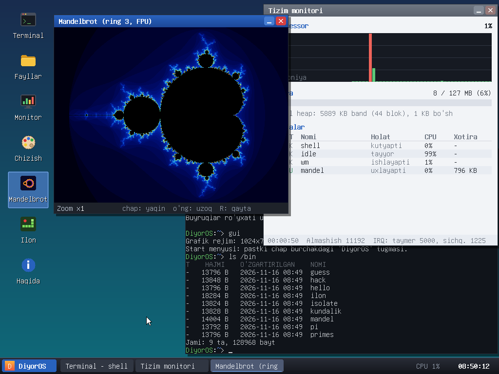

# v0.7 — Grafik interfeys: oynalar, sichqoncha, dasturlar



Bu bosqichda DiyorOS matn rejimidan (80x25 belgi) to'liq grafik interfeysga o'tdi:
1024x768 piksel, 16 million rang, sichqoncha ko'rsatkichi, sudrab ko'chiriladigan oynalar,
vazifalar paneli, Start menyusi va 7 ta grafik dastur. Ikkitasi (Mandelbrot va Ilon) **ring 3
da**, oddiy dastur sifatida ishlaydi va ekranga faqat syscall orqali chiqadi.

Hammasi noldan yozilgan: grafika kutubxonasi, shrift chizish, oyna menejeri, kompozitor.
Yangi kod: ~4 000 qator (jami ~15 000).

---

## 1. Ishga tushirish

```
make run
```

DiyorOS odatdagidek matn rejimida yuklanadi. Keyin:

```
gui
```

Grafik rejimdan chiqish: **DiyorOS** (Start) → **Matn rejimiga qaytish**. Shell va ishlab
turgan dasturlar to'xtamaydi: matn ekranga qaytadi.

**Mac'da sichqoncha:** QEMU oynasiga bir marta bosing — sichqoncha DiyorOS'ga "ushlanadi".
Mac'ga qaytarish: **Ctrl + Option + G**.

| Joy | Nima qiladi |
|---|---|
| Ish stolidagi ikonka | ikki marta bosish — dasturni ochish |
| Oyna sarlavhasi | bosib sudrash — oynani ko'chirish |
| `_` / `x` tugmalari | kichraytirish / yopish |
| Pastki panel | oyna tugmasi: faollashtirish yoki kichraytirish; o'ngda soat va CPU |
| **DiyorOS** tugmasi | Start menyusi: dasturlar, matn rejimi, qayta yuklash, o'chirish |
| Terminal | shell xuddi avvalgidek; g'ildirak — tarixni varaqlash |

---

## 2. Dasturlar

| Dastur | Qayerda ishlaydi | Nimani ko'rsatadi |
|---|---|---|
| **Terminal** | kernel | Shell grafik oynada. Ichida `edit`, dasturlar, Ctrl+C — hammasi ishlaydi |
| **Fayllar** | kernel | VFS orqali har qanday papka: `/home`, `/proc`, `/disk` (FAT32). Ikki marta bosish: papka — kirish, `/bin` dagi fayl — dasturni ishga tushirish, `.bmp` — rasm, boshqasi — matn ko'ruvchi |
| **Tizim monitori** | kernel | 60 soniyalik CPU grafigi, RAM va heap, vazifalar jadvali, uzilishlar soni. Har soniyada yangilanadi |
| **Chizish** | kernel | 12 rang, 3 qalinlik, o'ng tugma — o'chirg'ich. **Saqlash** rasmni `/disk/rasm1.bmp` ga yozadi |
| **Haqida** | kernel | Tizim ma'lumotlari |
| **Mandelbrot** | **ring 3** (`/bin/mandel`) | FPU bilan hisoblaydi; chap tugma — 2 marta yaqinlashish, o'ng — uzoqlashish |
| **Ilon** | **ring 3** (`/bin/ilon`) | O'yin: strelkalar yoki WASD, P — pauza, R — qayta |

Chizish dasturida saqlangan BMP haqiqiy fayl: Mac'da `disk.img` ichidan olib, Preview'da
ochsa bo'ladi (Linux'da tekshirildi: `mcopy` + ImageMagick).

---

## 3. Qanday ishlaydi

### 3.1. Matn rejimi → grafik rejim

Matn rejimida videokartaga "shu katakda shu harf" deymiz, harfni piksellarga videokartaning
o'zi aylantiradi. Grafik rejimda **har bir pikselni o'zimiz** boshqaramiz.

**Framebuffer** — videokarta xotirasining bir qismi: unga yozilgan son darhol ekranda rang bo'lib
chiqadi. 1024x768 ekran = 786 432 piksel × 4 bayt = **3 MB**. Piksel `0x00RRGGBB`: qizil,
yashil, ko'k (har biri 0–255).

**Videokartani qanday topamiz — PCI** (`src/drivers/pci.c`). Kompyuterdagi qurilmalar PCI
shinasiga ulangan. Har birining 256 baytlik "konfiguratsiya maydoni" bor: ishlab chiqaruvchi,
qurilma turi va **BAR** (Base Address Register) — qurilma xotirasi qayerda. Uni ikki port orqali
o'qiymiz: `0xCF8` (manzil) va `0xCFC` (ma'lumot). Videokartaning BAR0 si framebuffer ning fizik
manzilini beradi (QEMU'da `0xFD000000`). Natijani `pci` buyrug'i ko'rsatadi.

**Rejimni yoqish — Bochs VBE** (`src/drivers/fb.c`). QEMU, Bochs va UTM dagi standart videokarta
oddiy interfeysga ega: `0x1CE` portiga registr raqami, `0x1CF` ga qiymat. Eni, bo'yi, rang chuqurligi
(32 bit) yoziladi va rejim yoqiladi. BIOS kerak emas — biz protected mode'damiz, BIOS
funksiyalarini chaqira olmaymiz.

**Framebuffer ni xaritaga kiritish.** Fizik `0xFD000000` virtual `0xE0000000` ga bog'lanadi.
Muhim nozik joy: jarayonlar kernel sahifa jadvallarini **yaratilgan paytda** nusxalaydi (v0.5).
Agar framebuffer jadvali keyinroq yaratilsa, oldin ishga tushgan jarayonlar uni ko'rmaydi.
Shuning uchun 16 MB lik hudud uchun jadvallar yuklanishda oldindan yaratiladi (heap bilan bir xil
usul).

### 3.2. Grafik rejim → matn rejimi (orqaga qaytish)

Bu qiyinroq qism. Protected mode'da BIOS yo'q, shuning uchun VGA ning ~60 ta registrini
(sequencer, CRTC, graphics controller, attribute controller) 80x25 matn rejimi qiymatlariga
**qo'lda** qaytaramiz.

Bundan tashqari: framebuffer videokarta xotirasining boshidan joylashadi va u yerda turgan
**shriftni** (VGA xotirasining 2-tekisligi) ustidan yozib yuboradi. Shuning uchun grafik rejimga
o'tishdan oldin shrift (8 KB) o'qib saqlanadi va qaytganda joyiga yoziladi. Aks holda matn
rejimida harflar o'rniga "axlat" chiqardi.

Shu mexanizm **kernel panic** da ham ishlaydi: grafik rejimda xato bo'lsa, `panic()` darhol matn
rejimiga o'tadi va xabar ko'rinadi (aks holda ekran shunchaki qotib qolardi).

### 3.3. Grafika kutubxonasi (`src/gfx/gfx.c`)

"Sirt" (surface) — piksellar massivi. Ekranning orqa buferi ham, har bir oynaning tasviri ham
sirt. Barcha amallar: piksel, to'rtburchak, chiziq (Bresenham algoritmi), doira, gradient, soya,
nusxalash, matn.

**Kesish (clipping):** har bir sirtning "kesish to'rtburchagi" bor. Oyna chetidan chiqib
ketgan chiziq boshqa xotirani buzmaydi — chizish funksiyasi avval to'rtburchaklar kesishmasini
hisoblaydi.

**Shrift** (`src/gfx/font.c`): har bir harf 8x16 piksel = 16 bayt, har bayt bitta qator, har bit
bitta piksel. Manba: X11 "misc-fixed" shrifti (public domain). `tools/mkfont.py` uni C massivga
aylantiradi. Qalin matn — bir piksel siljitib ikki marta chizish. Katta matn — har pikselni kvadrat
qilib chizish.

### 3.4. Oyna menejeri va kompozitor (`src/gui/wm.c`)

```
sichqoncha (IRQ12) --\
                      >-- kirish navbati --> "wm" oqimi --> oynalar, menyu, panel
klaviatura (IRQ1) ---/                           |
                                                 v
dasturlar (syscall) --> oyna sirtlari --> KOMPOZITSIYA --> orqa bufer --> framebuffer
```

- **Uzilishlar faqat navbatga yozadi.** Uzilish ichida uzoq ish qilinmaydi (u paytda boshqa
  uzilishlar kutib turadi). Ketma-ket sichqoncha siljishlari navbatda birlashtiriladi.
- **`wm` — alohida kernel oqimi** (`ps` da ko'rinadi). ~100 marta soniyada uyg'onadi: navbatni
  qayta ishlaydi, kerak bo'lsa ekranni yangilaydi va uxlaydi. Bo'sh turganda CPU ~0%.
- **Har bir oynaning o'z sirti bor.** Dastur faqat o'z sirtiga chizadi. Oyna menejeri ularni
  pastdan yuqoriga (z-tartib) ustma-ust qo'yib, bitta tasvir yig'adi. Shuning uchun bir oyna
  ikkinchisini "buzmaydi" va oyna surilganda ostidagi dastur qayta chizishi shart emas.

**Ikki bufer (double buffering).** Hamma narsa avval oddiy xotiradagi orqa buferga chiziladi,
tayyor natija bir martada framebuffer ga ko'chiriladi. To'g'ridan-to'g'ri ekranga chizilsa,
foydalanuvchi yarim chizilgan oynalarni ko'rardi (miltillash).

**Iflos hudud (dirty rectangle).** Har safar 3 MB ni qayta yig'ish qimmat. Faqat o'zgargan joy
belgilanadi: sichqoncha siljisa — ko'rsatkichning eski va yangi joyi (12x19 piksel), terminalga
harf chiqsa — o'sha qator. Kompozitsiya va ko'chirish faqat shu to'rtburchak ichida bo'ladi.

**Sichqoncha** (`src/drivers/mouse.c`). PS/2 paketi: 1-bayt — tugmalar va ishora bitlari,
2–3-bayt — X/Y siljish (9 bitli ishorali son), 4-bayt — g'ildirak. Sichqoncha nisbiy siljish
yuboradi, joyini oyna menejeri o'zi hisoblaydi va ekran chegarasida ushlab turadi.

**Tezlik va silliqlik.** Tezlik `mouse 1..10` buyrug'i bilan o'zgaradi (5 — bir birlik = bir
piksel). Siljish tezlikka ko'paytirilib 5 ga bo'linadi, **qoldiq esa keyingi paketga qo'shiladi**
(sub-piksel aniqlik). Shunda sekin tezlikda ham kursor tekis yuradi, "zinapoya" bo'lmaydi.
Birinchi variantda tezlashtirish (`d + d·|d|/8`) bor edi: tez harakatda kursor sakrab ketardi,
shuning uchun olib tashlandi.

Ikkinchi sabab — kechikish. Avval oyna menejeri faqat taymer tikida (har 10 ms) uyg'onardi:
sichqoncha paketi 0 dan 10 ms gacha kutib qolardi va harakat notekis ko'rinardi. Endi sichqoncha
uzilishi oyna menejerini **darhol** uyg'otadi (`task_wake`): uzilishdan chiqqan zahoti
scheduler `wm` ga o'tadi va kursor chiziladi. Sichqoncha paket tezligi ham 80 dan 200 ga
oshirildi (haqiqiy sichqonchada seziladi).

**Klaviatura fokusi.** Tugma avval oyna menejeriga beriladi (`keyboard_set_hook`). Faol oyna
terminal bo'lsa — tugma odatdagidek shell buferiga tushadi; boshqa oyna bo'lsa (masalan, o'yin) —
o'sha oynaga ketadi va shell uni ko'rmaydi. Ctrl+C doim shell'ning oldingi plandagi dasturini
to'xtatadi.

**Qulf.** Oynalar ro'yxatini `wm` oqimi ham, dasturlar ham (syscall orqali) o'zgartiradi.
Oddiy qulf ishlatiladi: band bo'lsa, vazifa navbatini beradi (`task_yield`) va keyin qayta
urinadi. Bu v0.8 dagi mutex ning sodda ko'rinishi.

### 3.5. Terminal: shell grafik rejimni sezmaydi (`src/gui/terminal.c`)

Shell, muharrir va dasturlar avvalgidek `vga_putc` / `kprintf` chaqiradi. Grafik rejimda
`vga.c` `0xB8000` o'rniga **xotiradagi nusxaga** (80x25 katak) yozadi. Har o'zgarishda
"avlod" hisoblagichi (`generation`) oshadi. Terminal oynasi har aylanishda uni tekshiradi va
faqat o'zgargan kataklarni shrift bilan qayta chizadi. VGA ning 16 rangi zamonaviy RGB palitraga
moslashtirilgan; kursor yonib-o'chadi.

Bu **abstraksiya qatlami** g'oyasi: pastki qatlam (ekran) almashdi, yuqori qatlam (shell,
2000+ qator kod) bir qator ham o'zgarmadi.

### 3.6. Ring 3 dagi grafik dasturlar — 4 ta yangi syscall

| Syscall | Vazifasi |
|---|---|
| `win_create(nom, eni, bo'yi)` | oyna yaratadi, raqamini qaytaradi |
| `win_update(raqam, piksellar)` | dastur xotirasidagi piksellarni oynaga ko'chiradi |
| `win_event(raqam, &hodisa)` | navbatdagi hodisa: tugma, sichqoncha, g'ildirak, yopish |
| `win_close(raqam)` | oynani yopadi |

Dastur ekranga **tegmaydi**: o'z xotirasidagi massivga chizadi va `win_update` bilan kernelga
beradi. Kernel tekshiradi: oyna shu jarayonnikimi (boshqa dasturning oynasiga yozib bo'lmaydi),
bufer butunligicha dasturning o'z xotirasidami (`user_ok`). Faqat shundan keyin nusxalaydi.

Dastur tugasa yoki o'ldirilsa, uning oynalari avtomatik yopiladi. `[x]` bosilganda dasturga
`GUI_EV_CLOSE` hodisasi yuboriladi; dastur javob bermasa, ikkinchi bosishda majburan
to'xtatiladi (Windows'dagi "Dastur javob bermayapti").

Dasturlar uchun kichik grafika kutubxonasi: `user/ugfx.c`. Shrift kernel bilan bir xil fayldan
kompilyatsiya qilinadi.

---

## 4. Boshqa o'zgarishlar

- `pci` — PCI qurilmalari ro'yxati (Linux'dagi `lspci`).
- `mouse <1-10>` — sichqoncha tezligi (5 — standart).
- `pi&` endi `pi &` kabi ishlaydi (`&` oldidan bo'sh joy shart emas).
- `hack 8` xabarni bir marta chiqaradi (avval har rekursiya qadamida chiqarib, ekranni to'ldirardi).
- O'chirish / qayta yuklash kodi `src/kernel/power.c` ga ko'chdi (shell va Start menyusi umumiy ishlatadi).
- `include/io.h`: 32-bitli portlar (`inl` / `outl`) — PCI uchun.

---

## 5. Demo ketma-ketligi (ustozga ko'rsatish)

```
pci                        qurilmalar: videokarta, disk kontrolleri, ko'priklar
gui                        grafik rejim
```

1. Terminalda `ls /bin`, `ps` — shell grafik oynada ham xuddi o'sha.
2. **Monitor** ikonkasi — CPU grafigi, xotira, vazifalar (`wm` oqimi ham ko'rinadi).
3. **Mandelbrot** — ring 3 dagi dastur; Monitor'da CPU 100% ga chiqadi, vazifalar ro'yxatida
   `U mandel` paydo bo'ladi. Bosib yaqinlashtiring.
4. **Ilon** — o'yin; klaviatura faol oynaga ketishini ko'rsating (terminalga yozilmaydi).
5. **Chizish** — biror narsa chizib **Saqlash** → **Fayllar** → **Disk** → `rasm1.bmp` ni
   ikki marta bosing: rasm diskdan qayta o'qiladi.
6. Oynani sudrang, kichraytiring, paneldan qaytaring.
7. Terminalda `mandel`, keyin Ctrl+C — dastur va oynasi yo'qoladi.
8. Start → **Matn rejimiga qaytish** — matn ekrani, shrift va tarix joyida.

---

## 6. Himoya savollari

**Matn rejimi va grafik rejim farqi nima?**
Matn rejimida biz faqat belgi kodini va rangini yozamiz, harfni videokarta chizadi (shrift uning
xotirasida). Grafik rejimda har bir piksel bizning qo'limizda: harflarni ham o'zimiz chizamiz.
Erkinlik ko'p, lekin ish ham ko'p: 2000 bayt o'rniga 3 MB.

**Framebuffer nima?**
Videokarta xotirasining protsessorga ochilgan qismi. Unga yozilgan har bir 4 bayt ekrandagi bitta
pikselning rangi. Biz uni sahifa jadvali orqali kernel manzil maydoniga ulaymiz (memory-mapped I/O).

**Nima uchun PCI kerak bo'ldi?**
Framebuffer qaysi fizik manzilda ekanini videokartaning o'zi aytadi — PCI konfiguratsiya
maydonidagi BAR0 registrida. Manzilni "qattiq yozib" qo'yish mumkin edi, lekin boshqa
kompyuterda u boshqacha bo'lishi mumkin.

**Ikki bufer (double buffering) nima uchun?**
Agar to'g'ridan-to'g'ri ekranga chizsak, monitor yarim chizilgan holatni ko'rsatishi mumkin:
avval fon, keyin oyna — miltillash. Orqa buferda tayyorlab, bir martada ko'chiramiz.

**Dirty rectangle nima va qancha tejaydi?**
Faqat o'zgargan to'rtburchak qayta yig'iladi. Sichqoncha siljiganda 3 MB o'rniga
2 × 12×19×4 ≈ 2 KB ko'chiriladi — ~1500 marta kam.

**Oynalar bir-birini qanday "buzmaydi"?**
Har bir oynaning o'z sirti (piksellar massivi) bor. Dastur faqat unga chizadi. Ekrandagi tasvirni
oyna menejeri yig'adi: pastdagi oynadan boshlab, yuqoridagisini ustiga. Bu kompozitsiya
(macOS, Windows 7+ va Linux'dagi Wayland ham shunday ishlaydi).

**Uzilish ichida nega darhol chizmaysiz?**
Uzilish paytida boshqa uzilishlar (taymer, klaviatura) kutib turadi. Chizish millisekundlab
davom etishi mumkin — tizim "qotib" qoladi. Shuning uchun uzilish faqat hodisani navbatga
qo'yadi (producer), `wm` oqimi esa keyin uni qayta ishlaydi (consumer). v0.1 dagi klaviatura
buferi bilan bir xil g'oya.

**Ring 3 dagi dastur ekranga qanday chizadi, axir unga apparatga tegish taqiqlangan-ku?**
To'g'ridan-to'g'ri chiza olmaydi. U o'z xotirasidagi massivga chizadi va `win_update` syscall i
bilan kernelga beradi. Kernel ko'rsatkichni tekshiradi (dasturning xotirasidami, hajmi to'g'rimi,
oyna shu dasturnikimi) va o'zi ko'chiradi. `hack 3` (ekran xotirasiga to'g'ridan-to'g'ri yozish)
hali ham "Segmentation fault" beradi.

**Nima uchun terminal kodini qayta yozmadingiz?**
Abstraksiya qatlami tufayli: shell `vga_putc` ni chaqiradi, u qayerga yozishini bilmaydi. Grafik
rejimda `vga.c` xotiradagi massivga yozadi, terminal oynasi uni chizadi. Ekran almashdi, shell
o'zgarmadi.

**Grafik rejimda kernel panic bo'lsa nima bo'ladi?**
`panic()` birinchi navbatda videokartani matn rejimiga qaytaradi (registrlar va shrift), keyin
xabarni chiqaradi. Oyna menejeriga tayanmaydi — u paytda uzilishlar o'chiq, `wm` ishlamaydi.

**Matn rejimiga qaytish nega murakkab?**
BIOS yo'q (protected mode). VGA ning ~60 ta registrini 80x25 rejim qiymatlariga qo'lda yozish
kerak. Bundan tashqari, framebuffer VGA xotirasidagi shriftni ustidan yozib yuboradi — uni
oldindan saqlab, keyin tiklash kerak.

**Sichqoncha nega silliq yurishi uchun oyna menejerini darhol uyg'otish kerak?**
Ekran faqat `wm` oqimi ishlaganda yangilanadi. U faqat taymer bilan (100 Hz) uyg'onsa, har bir
sichqoncha paketi 0–10 ms tasodifiy kutadi: kursor notekis yuradi. `task_wake` uni uzilishdan
chiqqan zahoti ishga tushiradi — bu "hodisaga asoslangan" (event-driven) rejalashtirish.

**Sinxronizatsiya qanday?**
Oynalar ro'yxatiga ikki tomondan murojaat bor: `wm` oqimi va syscall'lar. Qulf ishlatiladi:
band bo'lsa — `task_yield` va qayta urinish. Bu "spin-yield" qulf; v0.8 dagi haqiqiy mutex
kutayotgan vazifani uxlatib, navbatga qo'yadi.

---

## 7. Qanday tekshirildi

- QEMU'da avtomatik sinovlar: sichqoncha QEMU monitori orqali boshqarildi (siljitish, bosish,
  ikki marta bosish, sudrash, g'ildirak), har bosqichdan keyin skrinshot olindi.
- Matn → grafik → matn → grafik: shrift, ranglar, tarix va kursor tiklanadi.
- Chizish → BMP diskka yozildi → `fsck.fat` xatosiz → Linux'da `mcopy` bilan olinib,
  ImageMagick ochdi → DiyorOS'ning o'zi ham Fayllar orqali ochdi.
- Xotira oqishi: 4 ta dastur oynasi 3 marta ochib-yopildi. Heap'dagi band xotira aynan avvalgidek
  (4 378 888 bayt, 40 blok), bo'sh joy bitta yaxlit blokka birlashdi.
- Grafik rejimda: `ilon` terminaldan ishga tushirildi va `q` bilan chiqildi; `mandel` + Ctrl+C;
  `hello`; `edit`; `crash` — panic matn rejimida ko'rindi.
- GRUB ISO orqali yuklash (UTM'dagi yo'l) — grafik rejim ishlaydi.
- `hack 1–8` — barcha himoyalar avvalgidek.
- `gcc -fanalyzer` va `cppcheck` — yangi kodda ogohlantirish yo'q.

---

## 8. Cheklovlar (halol ro'yxat)

- Faqat **Bochs VBE** videokartasi (QEMU, Bochs, UTM'dagi "VGA"). Haqiqiy
  kompyuterda grafik rejim uchun GRUB'ning VBE/GOP framebuffer ini qabul qilish kerak — v1.0 ishi.
- O'lcham qat'iy: 1024x768. Oynalar o'lchamini o'zgartirib bo'lmaydi (faqat ko'chirish).
- Sichqoncha nisbiy (PS/2). QEMU oynasida "ushlash" kerak (Ctrl+Option+G bilan qo'yib yuboriladi).
  Mutlaq koordinatali qurilma (USB tablet) uchun USB drayveri kerak.
- Bitta shrift (8x16, faqat ASCII). O'zbekcha `o'`, `g'` apostrof bilan yoziladi.
- Kernel heap faqat o'sadi: grafik dasturlar yopilgach xotira heap ichida qayta ishlatiladi,
  lekin PMM ga qaytarilmaydi (v0.6.1 dan ma'lum cheklov).
- Kompozitsiya bitta protsessorda, dasturiy (GPU ishlatilmaydi).
