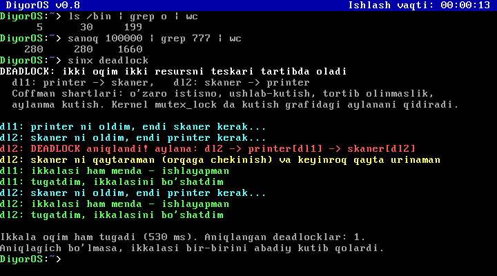

# v0.8 — Sinxronizatsiya, kanallar va jarayonlar o'rtasidagi aloqa



Bu bosqichda DiyorOS'ga OS nazariyasining eng ko'p so'raladigan mavzusi qo'shildi:
**bir vaqtda ishlayotgan vazifalarni muvofiqlashtirish**.

- **Mutex** — o'zaro istisno qulfi: navbat bilan (FIFO), **deadlock aniqlash** bilan
- **Semafor** — hisoblagichli qulf (Dijkstra)
- **Kutish navbatlari** — vazifa hodisani band-kutishsiz (busy wait), uxlab kutadi
- **Kanallar (pipe)** — `ls /bin | grep o | wc`: bir dasturning chiqishi ikkinchisining kirishiga
- **Yo'naltirish** — `sanoq 100 > /disk/son.txt`, `ps >> log`, `wc < fayl`
- **Dasturdan dastur ishga tushirish** — `spawn`, `wait`, `pipe` syscall'lari
- **Signallar** — Ctrl+C butun kanalni (jarayon guruhini) to'xtatadi; `kill` xavfsiz bo'ldi
- **Preemptive kernel** — syscall bajarilayotganda ham uzilishlar yoqiq; diskka yozish
  paytida sichqoncha va boshqa dasturlar qotmaydi
- `sinx` buyrug'i — 4 ta klassik masala namoyishi: poyga, ishlab chiqaruvchi–iste'molchi,
  deadlock, ovqatlanayotgan faylasuflar

Yangi kod: ~2 100 qator (jami ~17 700, shrift faylisiz).

---

## 1. Ishga tushirish va yangi buyruqlar

```
make run
```

| Buyruq | Nima qiladi |
|---|---|
| `ls /bin \| grep o \| wc` | Kanal: `ls` (shell ichki buyrug'i) → `grep` → `wc` |
| `sanoq 100000 \| grep 777 \| wc` | Uchta dastur parallel ishlaydi, ma'lumot 4 KB li kanallar orqali oqadi |
| `sanoq 1000000 \| head 3` | `head` 3 qatordan keyin tugaydi → `sanoq` "broken pipe" bilan to'xtaydi |
| `sanoq 3000 > /disk/son.txt` | Dastur chiqishi faylga (diskka) |
| `ps >> /tmp/log.txt`, `wc < /tmp/log.txt` | Qo'shib yozish va fayldan o'qish |
| `ota` | Dastur o'zi `spawn` + `wait` + `pipe` ishlatadi |
| `sinx poyga` | Race condition: qulfsiz `counter++` qiymatlarni yo'qotadi, mutex bilan — to'g'ri |
| `sinx ishlab` | Producer–consumer: 2 ishlab chiqaruvchi, 2 iste'molchi, 5 o'rinli bufer |
| `sinx deadlock` | Ikki oqim qulflarni teskari tartibda oladi → kernel aylanani aniqlaydi |
| `sinx faylasuflar` | 5 faylasuf — 5 tali aylana deadlock aniqlanadi |
| `sinx faylasuflar tartib` | Yechim: resurslarni tartiblash — deadlock umuman bo'lmaydi |
| `cat /proc/sync` | Barcha mutex, semafor va kanallar holati, statistikasi |
| `ps` | Endi kutayotgan vazifa **nimani** kutayotgani ko'rinadi: `kutadi: pipe o'qish` |

Yangi dasturlar (`/bin`): `wc`, `grep` (`-v -c -i`), `head`, `sanoq`, `ota`.
`wc` endi shell buyrug'i emas, dastur — chunki kanalning o'rtasida yoki oxirida faqat stdin'dan
o'qiy oladigan dastur tura oladi. Klaviaturadan kiritishni tugatish: bo'sh qatorda **Ctrl+D**.

---

## 2. Muammo: race condition

`counter++` bitta amal bo'lib ko'rinadi, aslida uchta:

```
1) counter ni registrga o'qish      v = counter
2) 1 qo'shish                       v = v + 1
3) xotiraga yozish                  counter = v
```

Taymer uzilishi istalgan joyda kelishi mumkin. 1- va 3-qadam orasida scheduler boshqa oqimga
o'tsa, u ham `counter` ni o'qib, bir necha ming marta oshiradi. Keyin birinchi oqim qaytib,
**eski** `v + 1` ni yozadi — boshqa oqimning hamma ishi yo'qoladi. `sinx poyga` natijasi:

```
1) Qulfsiz:     natija 72887, kutilgan 90000 -> 17113 ta qo'shish YO'QOLDI
2) Mutex bilan: natija 90000, kutilgan 90000 -> TO'G'RI
```

Har ishga tushirishda yo'qotish soni boshqacha — bu race condition'ning asosiy belgisi:
natija vaqtga bog'liq, xato esa takrorlash qiyin.

**Kritik seksiya** — umumiy ma'lumotni o'zgartiradigan kod qismi. Unga bir paytda faqat bitta
oqim kirishi kerak (**o'zaro istisno**, mutual exclusion).

### v0.6.1 dagi yechim va uning kamchiligi

v0.6.1 da kritik seksiyalar uzilishlarni o'chirib bajarilardi (`irq_save`/`irq_restore`).
Bitta protsessorda bu to'g'ri ishlaydi, lekin:

- uzilishlar o'chiq paytda **taymer, klaviatura, sichqoncha kutadi**. FAT32 ga katta fayl
  yozish millisekundlab davom etadi — shu paytda butun tizim "qotadi";
- kutish kerak bo'lsa (masalan, kanal to'la), uzilishlarni o'chirib kutib bo'lmaydi;
- ko'p protsessorli tizimda umuman ishlamaydi (boshqa yadro uzilishlarga qaramaydi).

v0.8 da uzoq kritik seksiyalar **mutex** bilan himoyalanadi. `irq_save` faqat juda qisqa
joylarda qoldi: mutexning o'zini amalga oshirishda (bir necha buyruq) va drayverlarning ichida.

---

## 3. Qanday ishlaydi

### 3.1. Kutish navbati (`src/kernel/sync.c`)

Hamma kutish mexanizmlarining asosi — **wait queue**: biror hodisani kutayotgan vazifalar
ro'yxati (FIFO). Vazifa:

1. o'zini navbatga qo'shadi va holatini `BLOCKED` qiladi;
2. `task_yield()` — protsessorni boshqalarga beradi. Scheduler `BLOCKED` vazifani tanlamaydi,
   shuning uchun u protsessor vaqtini **umuman sarflamaydi** (band-kutishdan farqi);
3. hodisa yuz berganda kimdir `wq_wake_one/all` chaqiradi → vazifa `READY` bo'ladi.

**Lost wakeup muammosi.** Agar "shartni tekshirdim → hali yo'q → (shu payt hodisa yuz berdi va
uyg'otuvchi hech kimni topmadi) → uxladim" bo'lsa, vazifa abadiy uxlab qoladi. Shuning uchun
shartni tekshirish va navbatga qo'shish **bo'linmas** bo'lishi shart: `wq_wait` uzilishlar
o'chiq holda chaqiriladi, uyg'otuvchi esa uzilishlarni o'chirib ishlaydi. Uyg'ongach vazifa
shartni `while` tsiklida **qayta** tekshiradi.

Kutish **uzilishli** (interruptible) bo'lishi mumkin: jarayonga signal kelsa (Ctrl+C), kutish
`SYNC_EINTR` bilan tugaydi. Klaviatura, kanal, semafor, `sleep`, `wait` — uzilishli;
mutex — yo'q: qulf qisqa vaqt ushlanadi (kutish tez tugaydi), kernel kodi esa qulfni
olmasdan davom eta olmaydi — signal baribir syscall oxirida ishlaydi.

### 3.2. Mutex

```c
mutex_lock(&m);     /* band bo'lsa — uxlab navbat kutadi */
... kritik seksiya ...
mutex_unlock(&m);   /* navbatdagi birinchi kutayotganga to'g'ridan-to'g'ri topshiradi */
```

- **Egasi bor**: faqat qulfni olgan vazifa uni ocha oladi. Boshqasi ochmoqchi bo'lsa — kernel
  panic (bu kernel kodidagi xato, jim o'tkazib bo'lmaydi).
- **Handoff va FIFO**: `mutex_unlock` qulfni ochib qo'ymaydi, uni navbatdagi kutayotganga
  **topshiradi**. Natijada navbat adolatli, hech kim "och qolmaydi" (starvation yo'q).
  Narxi — *lock convoy*: `sinx poyga` da mutex bilan ~20–30% sekinroq, chunki qulf har safar
  uxlab yotgan vazifaga o'tadi va u scheduler navbatini kutadi.
- **Rekursiv** variant: VFS qulfi. VFS funksiyalari bir-birini chaqiradi (`vfs_open` →
  `vfs_lookup` → FAT32 drayveri). Egasi qulfni yana so'rasa, faqat hisoblagich oshadi.
- O'z-o'zini deadlock (rekursiv bo'lmagan qulfni egasi qayta so'rasa) — panic, sababi bilan.
- Statistika: necha marta olingan, necha marta band bo'lgan, deadlocklar — `/proc/sync`.

Tizimdagi mutexlar:

| Mutex | Nimani himoya qiladi |
|---|---|
| `vfs` (rekursiv) | fayl deskriptorlari jadvali, papkalar daraxti, ramfs, FAT32 (FAT, kesh, papkalar) |
| `ata` | disk kontrolleri: bir vaqtda faqat bitta buyruq |
| `wm` | oynalar ro'yxati, kompozitor (avval yield-spin qulf edi) |
| `konsol`, `poyga`, `bufer`, `printer`, `skaner`, `vilka1..5` | `sinx` namoyishlari |

### 3.3. Semafor

Semafor — butun son va kutish navbati:

- `sem_down` (P, *wait*): son > 0 bo'lsa kamaytiradi, aks holda uxlab kutadi;
- `sem_up` (V, *signal*): sonni oshiradi va bitta kutayotganni uyg'otadi.

Son = 1 bo'lsa mutexga o'xshaydi (lekin egasi yo'q — istalgan vazifa `up` qila oladi).
Son = N bo'lsa — "N ta resurs bor".

**Producer–consumer** (`sinx ishlab`):

```
bo'sh = 5   (bo'sh o'rinlar)       to'la = 0   (tayyor mahsulotlar)

Ishlab chiqaruvchi:                Iste'molchi:
  sem_down(bo'sh)                    sem_down(to'la)
  mutex_lock(bufer)                  mutex_lock(bufer)
  buferga qo'yish                    buferdan olish
  mutex_unlock(bufer)                mutex_unlock(bufer)
  sem_up(to'la)                      sem_up(bo'sh)
```

Ikkala semafor sanaydi, mutex esa indekslarni himoya qiladi. Agar tartib almashtirilsa
(avval `mutex_lock`, keyin `sem_down`), bufer to'la paytda ishlab chiqaruvchi qulfni ushlab
uxlaydi, iste'molchi esa qulfga kira olmaydi — **deadlock**. Bu himoyada tez-tez so'raladi.

### 3.4. Deadlock: aniqlash, oldini olish, chiqish

Deadlock uchun to'rtta shart bir vaqtda bajarilishi kerak (**Coffman shartlari**):

1. **O'zaro istisno** — resursni bir paytda bitta vazifa ushlaydi;
2. **Ushlab turib kutish** — vazifa bittasini ushlab, boshqasini kutadi;
3. **Tortib olinmaslik** — resursni egasidan majburan olib bo'lmaydi;
4. **Aylanma kutish** — T1 → T2 → ... → T1.

**Aniqlash (DiyorOS).** Har bir vazifada `waiting_mutex` (qaysi qulfni kutyapti), har bir
mutexda `owner` bor. Bu — **kutish grafi** (wait-for graph). `mutex_lock` uxlashdan oldin
zanjir bo'ylab yuradi:

```
so'ralgan mutex → uning egasi → u kutayotgan mutex → uning egasi → ... → men?
```

Zanjir o'zimizga qaytsa — aylana. Bunday holda vazifa uxlamaydi, `SYNC_EDEADLK` qaytadi va
jurnalga (`dmesg`) aylana yoziladi:

```
deadlock: dl2(7) -> printer [dl1(6)] -> skaner [dl2(7)]
```

Tekshiruv O(n) (n ≤ 16 vazifa), faqat qulf band bo'lganda bajariladi. Linux yadrosi POSIX fayl
qulflarida (`fcntl` `F_SETLKW`) aynan shunday zanjirni tekshirib `EDEADLK` qaytaradi;
ma'lumotlar bazalari tranzaksiya qulflarida ham shu usulni ishlatadi. (Linux'dagi `lockdep`
boshqacha: u ishlash paytida qulflar olingan **tartibni** yozib boradi va tartib buzilsa
ogohlantiradi — deadlock hali yuz bermasdan.)

**Chiqish (recovery).** `EDEADLK` olgan vazifa o'zi ushlab turgan qulfni qaytaradi (endi u
"ushlab turib kutmayapti" — 2-shart buziladi, aylana uziladi), biroz kutib, qayta urinadi —
`sinx deadlock` va `sinx faylasuflar` shunday ishlaydi.

**Oldini olish (prevention).** `sinx faylasuflar tartib`: vilkalar raqamlangan va har bir
faylasuf avval **kichik raqamlisini** oladi. Aylana hosil bo'lishi mumkin emas (4-shart
buziladi) — aniqlagichga ish qolmaydi: "Aniqlangan deadlocklar: 0".

**Qulf ushlagan vazifani o'ldirish.** Vazifa qulf ushlab turganda o'ldirilsa, qulf abadiy yopiq
qoladi, himoyalangan ma'lumot esa yarim o'zgargan bo'ladi. Shuning uchun `kill` hech kimni
qulf ushlagan holda o'ldirmaydi: user jarayon — signal orqali (3.6-bo'lim), kernel oqimi esa
mutex ushlab turgan bo'lsa belgilanadi va **oxirgi qulfini bo'shatganda** (`mutex_unlock`
ichida) o'zi tugaydi. Zaxira sifatida `sync_task_died` ham bor: vazifa baribir qulf bilan
tugasa (kod xatosi), qulflari navbatdagiga topshiriladi va `owner_died` hisoblagichi oshadi
(*robust mutex* g'oyasi).

### 3.5. Preemptive kernel

v0.7 gacha `int 0x80` (syscall) uzilishlar **o'chiq** holda bajarilardi: syscall bo'linmas edi,
bu himoyalash uchun qulay, lekin dastur diskka yozayotganda butun tizim kutardi.

v0.8 da `syscall_handler` boshida `sti` — syscall o'rtasida ham taymer uzilishi kelib,
scheduler boshqa vazifaga o'tishi mumkin. Buning uchun hamma umumiy ma'lumot qulf bilan
himoyalanishi kerak edi:

| Ma'lumot | Himoya |
|---|---|
| VFS, ramfs, FAT32, fd jadvali | `vfs` mutexi (rekursiv) |
| ATA disk | `ata` mutexi |
| Oynalar | `wm` mutexi |
| Fizik xotira, kernel heap, vazifalar jadvali, VGA | qisqa `irq_save` (bir necha mikrosekund) |
| Jarayonning o'z sahifa jadvali (`sbrk`) | himoya kerak emas — uni faqat jarayonning o'zi o'zgartiradi |

Syscall'dan qaytishda (`iret` oldidan) uzilishlar yana o'chiriladi.

### 3.6. Signallar: xavfsiz `kill` va Ctrl+C

Preemptive kernelda yangi muammo paydo bo'ldi: `kill` jarayonni **darhol** o'ldirsa, u shu payt
syscall ichida `vfs` mutexini ushlab turgan bo'lishi mumkin. Qulf hech qachon ochilmaydi,
fayl tizimi esa yarim o'zgartirilgan holda qoladi.

Yechim — **kechiktirilgan signal** (Unix'dagi signallar g'oyasi):

1. `kill` / Ctrl+C jarayonga faqat belgi qo'yadi: `kill_pending = true` va uni uyg'otadi;
2. jarayon kernel ishini tugatadi va **user rejimga qaytayotganda** (`idt.c`, har bir syscall
   va uzilish oxirida `task_check_signals`) belgini ko'rib, o'zi chiqadi — bu nuqtada u hech
   qanday kernel qulfini ushlamaydi;
3. jarayon uzilishli kutishda turgan bo'lsa (klaviatura, kanal, semafor, `sleep`, `wait`),
   kutish `EINTR` bilan tugaydi, syscall qaytadi, keyin 2-qadam.

Jarayon tugashida (`task_exit_code`) uning hamma fayl va kanal deskriptorlari **darhol**
yopiladi. Shuning uchun `ls | wc` da birinchi dastur tugashi bilan `wc` EOF ni ko'radi.

**Jarayon guruhlari (pgid).** Kanaldagi hamma dasturlar bitta guruhda (pgid = birinchi dastur
PID). Klaviatura guruhga tegishli: `sanoq 100000000 | grep 7 | wc` da Ctrl+C uchala dasturni
to'xtatadi. Fondagi jarayon klaviaturadan o'qimoqchi bo'lsa, u to'xtatiladi (Unix'dagi `SIGTTIN`).

### 3.7. Kanallar (`src/fs/pipe.c`)

```
  sanoq (stdout = fd 1)                                   wc (stdin = fd 0)
        │  write(1, ...)                                        ▲ read(0, ...)
        ▼                                                       │
  ┌────────── kernel: 4 KB aylanma bufer ──────────────────────────┐
  │ head ─►  [ 1 \n 2 \n 3 \n 4 \n ......... ]   ◄─ head + count     │
  └──────────────────────────────────────────────────────────────────┘
     bufer to'la → yozuvchi uxlaydi (wq)     bufer bo'sh → o'quvchi uxlaydi (rq)
```

Bu ham producer–consumer, lekin kernel ichida va dasturlar uchun ko'rinmas:

- bufer bo'sh → `read` uxlaydi; bufer to'la → `write` uxlaydi (**backpressure**: tez yozuvchi
  sekin o'quvchini bosib ketmaydi, xotira o'smaydi);
- barcha **yozish** uchlari yopilsa va bufer bo'sh bo'lsa → `read` 0 qaytaradi (**EOF**);
- barcha **o'qish** uchlari yopilsa → `write` `EPIPE` qaytaradi va jarayon to'xtatiladi
  (Unix'dagi `SIGPIPE`). `sanoq 1000000 | head 3` da `sanoq` million sonni bekorga hisoblamaydi.

Kanal uchlari — oddiy fayl deskriptorlari (VFS jadvalida `node` o'rniga `pipe`). Dastur
`read(0, ...)` qiladi va qayerdan o'qiyotganini bilmaydi: klaviatura, fayl yoki kanal —
"hamma narsa fayl" (Unix falsafasi).

**Muhim nuance.** Kanaldan o'qish/yozish uxlashi mumkin, shuning uchun u `vfs` qulfini
**ushlamasdan** bajariladi. Aks holda `wc` ma'lumot kutib qulfni ushlab tursa, `sanoq`
deskriptoriga ham kira olmasdi — deadlock.

### 3.8. `spawn`, `wait`, `pipe` syscall'lari

| № | Syscall | Ma'nosi |
|---|---|---|
| 17 | `spawn(yo'l, argumentlar, io[2])` | Yangi dastur; `io` = {stdin, stdout}, -1 — otasinikidan meros. Bola PID |
| 18 | `wait(pid, &kod)` | O'z bolasining tugashini kutish, chiqish kodini olish; zombini tozalaydi |
| 19 | `pipe(fds[2])` | Kanal: `fds[0]` — o'qish, `fds[1]` — yozish uchi |

**Nega `fork()` emas?** Unix'da yangi dastur `fork()` (butun jarayon xotirasini nusxalash) +
`exec()` (uni yangi dastur bilan almashtirish) bilan ishga tushiriladi. `fork` uchun
copy-on-write sahifalar kerak — bu alohida katta ish. `spawn` bitta qadamda yangi dasturni
yuklaydi: Windows'dagi `CreateProcess` va POSIX'dagi `posix_spawn` kabi.

Bolaning stdin/stdout deskriptorlari ota deskriptorlarining **nusxasi** (`vfs_dup`), ular
bolaga topshiriladi (egasi o'zgaradi) va u tugaganda yopiladi. Bitta jarayon ko'pi bilan
4 ta bola ochishi mumkin (fork-bomba bo'lmasin).

**Zombi.** Tugagan jarayon darhol yo'qolmaydi: chiqish kodi saqlanib turadi (`ZOMBIE`).
Otasi tirik user dastur bo'lsa — zombini u `wait()` bilan o'zi yig'adi; ota tugagach,
"yetim" zombilarni shell tozalaydi.

`ota` dasturi buni ko'rsatadi: `hello` ni ishga tushirib kodini oladi, keyin kanal yaratib
`wc` ga 300 qator yuboradi (9,5 KB — 4 KB buferdan katta: bufer to'lganda ota uxlaydi, `wc`
o'qib joy bo'shatgach davom etadi).

### 3.9. Shell: `a | b | c` va `>`

1. Qator `|` bo'yicha bo'linadi (ko'pi bilan 4 bosqich), N−1 ta kanal yaratiladi.
2. Barcha dasturlar **birdaniga** ishga tushiriladi — ular parallel ishlaydi.
3. Birinchi bosqich shellning ichki buyrug'i bo'lsa (`ls`, `cat`, `ps`, `echo`...), u shell
   ichida bajariladi, uning ekranga chiqishi ushlab olinadi (`vga_set_capture`) va kanalga
   yoziladi. Chiqish avval xotiraga yig'iladi (64 KB gacha) — ichki buyruq qulf ushlab ekranga
   yozganda kanal to'lib qotib qolmasligi uchun.
4. Shell o'zidagi kanal uchlarini yopadi. Bu juda muhim: yozish uchi shellda ochiq qolsa,
   `wc` hech qachon EOF ni ko'rmasdi va abadiy kutardi.
5. Hammasini kutadi va zombilarni tozalaydi.

`>` / `>>` / `<`: fayl ochiladi va uning deskriptori dasturga stdout/stdin sifatida beriladi.
Ichki buyruq uchun — ushlab olingan chiqish faylga yoziladi (`ls > /disk/royxat.txt`).

---

## 4. Boshqa o'zgarishlar

- `ps`, Tizim monitori va `/proc/tasks` — kutayotgan vazifa nimani kutayotgani (`klaviatura`,
  `pipe o'qish`, `mutex vfs`, `wait`, `semafor`) va jarayon guruhi (PGID).
- `/proc/sync` — mutexlar (egasi, kutuvchilar, statistika), semaforlar, ochiq kanallar.
- Oyna menejeri qulfi: yield-spin o'rniga haqiqiy mutex.
- FAT32 va ATA: uzilishlarni o'chirish o'rniga mutex.
- Dastur `exec` qilinayotganda fayl `vfs` qulfi ostida o'qiladi (o'qish paytida o'zgarmasin).
- `isatty()` (libc): dastur chiqishi ekranga ketyaptimi yoki kanalga — `grep` ekranda topilgan
  so'zni rangli ko'rsatadi, kanalga esa toza matn beradi.
- Klaviaturadan o'qishda Ctrl+D (bo'sh qatorda) — kiritish tugadi (EOF).
- Ekran rangi (`setcolor`) endi har bir jarayonniki: ikki dastur bir vaqtda yozsa ham
  bir-birining rangini buzmaydi, kanalga yozayotgan dastur ekran rangini o'zgartirmaydi.
- Klaviaturani kutayotganlar — kutish navbatida (avval bitta ko'rsatkich edi).
- Yo'naltirilgan stdout/stdin deskriptorlari dasturdan yashirin: dastur ularga faqat fd 0 / fd 1
  orqali murojaat qiladi, raqamini topib `close()` qila olmaydi.
- Ota va bola bitta faylga yozsa (`ota > log.txt`), yozuvlar ketma-ket qo'shiladi
  (bir-birining ustidan yozilmaydi).
- `dastur > /disk/fayl` da diskda joy tugasa, ekranga bir marta xabar chiqadi:
  `[PID 5] grep: chiqishni yozib bo'lmadi: diskda joy qolmadi`.
- To'la diskka yozish urinishi darhol rad etiladi (avval har safar butun FAT o'qilardi).
- `kill` oyna menejerini o'ldirmaydi — grafik rejimni tartib bilan yopadi.
- `sinx` namoyishi uchun vazifalar jadvalida joy yetmasa — aniq xabar.

---

## 5. Demo ketma-ketligi (ustozga ko'rsatish)

```
sinx poyga                     # 1. Muammo: qulfsiz natija noto'g'ri, mutex bilan to'g'ri
sinx ishlab                    # 2. Semaforlar: bufer to'ladi -> ishlab chiqaruvchi kutadi
sinx deadlock                  # 3. Deadlock aniqlanadi, aylana ko'rsatiladi, chiqish
sinx faylasuflar               # 4. 5 tali aylana
sinx faylasuflar tartib        #    ... va uning oldini olish: 0 ta deadlock
cat /proc/sync                 # 5. Hamma qulflarning statistikasi (vfs egasi - cat o'zi)
ls /bin | grep o | wc          # 6. Kanal: ichki buyruq -> dastur -> dastur
sanoq 100000 | grep 777 | wc   # 7. Uchta dastur parallel, 4 KB bufer
sanoq 1000000 | head 3         # 8. Broken pipe: sanoq o'zi to'xtaydi
sanoq 100000000 | grep 7 | wc  #    keyin Ctrl+C -> uchalasi to'xtaydi
ps                             #    hech narsa qolmagan
sanoq 3000 > /disk/son.txt     # 9. Yo'naltirish, diskka
wc < /disk/son.txt
ota                            # 10. Dastur o'zi spawn/wait/pipe ishlatadi
```

Grafik rejimda: `gui` → Tizim monitori ochiq turganda terminalda `sinx ishlab` — monitorda
oqimlarning holati (`semafor`, `qulf bufer`) ko'rinadi.

---

## 6. Himoya savollari

**Race condition nima? Misol keltiring.**
Natija vazifalarning bajarilish tartibiga (vaqtga) bog'liq bo'lib qolishi. `counter++` —
o'qish, qo'shish, yozish; o'rtada boshqa oqimga o'tilsa, uning o'zgarishlari ustidan yoziladi.
`sinx poyga`: 90 000 o'rniga ~73 000.

**Kritik seksiya nima va unga qanday talablar qo'yiladi?**
Umumiy ma'lumot bilan ishlaydigan kod qismi. Talablar: o'zaro istisno (bir paytda bitta),
progress (bo'sh bo'lsa kirmoqchi bo'lgan kirsin), cheklangan kutish (hech kim abadiy kutmasin).
DiyorOS mutexi uchalasini bajaradi: FIFO handoff cheklangan kutishni kafolatlaydi.

**Mutex va semafor farqi?**
Mutexning egasi bor — faqat olgan vazifa ochadi; u o'zaro istisno uchun. Semafor — hisoblagich,
egasi yo'q: bir vazifa `down`, boshqasi `up` qilishi mumkin; u resurslarni sanash va
signal berish (hodisani kutish) uchun. Producer–consumer'da ikkalasi ham kerak.

**Nega uzilishlarni o'chirish yetarli emas?**
Faqat bitta protsessorda ishlaydi; uzilishlar o'chiq paytda taymer, klaviatura, sichqoncha
kutadi; bunday holatda uxlab kutib bo'lmaydi. Uzilishlarni o'chirish faqat juda qisqa
seksiyalar uchun (mutexning o'zini qurish uchun) ishlatiladi.

**Spinlock va uxlaydigan mutex farqi?**
Spinlock — band bo'lsa tsiklda aylanib turadi (protsessor yonadi); ko'p protsessorda, juda
qisqa seksiya uchun foydali. Bitta protsessorda spinlock ma'nosiz — egasi biz aylanayotganda
ishlay olmaydi. DiyorOS mutexi uxlaydi (`BLOCKED`).

**Lost wakeup nima, qanday oldi olingan?**
Shartni tekshirish va uxlash orasida hodisa yuz bersa, uyg'otish yo'qoladi. `wq_wait`
uzilishlar o'chiq holda navbatga qo'shadi va `BLOCKED` qiladi — bu ikki qadam bo'linmas.

**Deadlock'ning to'rt sharti? DiyorOS ulardan qaysi birini qanday buzadi?**
O'zaro istisno, ushlab-kutish, tortib olinmaslik, aylanma kutish. Aniqlagich aylanani topadi,
vazifa qulfini qaytaradi (ushlab-kutishni buzadi). `faylasuflar tartib` — resurslarni
tartiblash aylanma kutishni imkonsiz qiladi.

**Deadlock bilan kurashishning to'rt usuli?**
1) e'tibor bermaslik ("tuyaqush algoritmi" — ko'p OS'lar shunday);
2) oldini olish (prevention — shartlardan birini buzish, masalan tartiblash);
3) chetlab o'tish (avoidance — Bankir algoritmi: resurs berishdan oldin xavfsiz holatni tekshirish);
4) aniqlash va tiklash (detection & recovery). DiyorOS 2- va 4-sini ko'rsatadi.

**Bankir algoritmi nima va nega ishlatilmagan?**
Har bir vazifa oldindan maksimal ehtiyojini e'lon qiladi; tizim resursni faqat "xavfsiz holat"
saqlansa beradi. Amalda vazifalar ehtiyojini oldindan bilmaydi, shuning uchun real OS'larda
deyarli ishlatilmaydi.

**Producer–consumer'da `sem_down` va `mutex_lock` tartibini almashtirsak nima bo'ladi?**
Bufer to'la paytda ishlab chiqaruvchi mutexni ushlab uxlaydi; iste'molchi mutexga kira olmaydi
va joy bo'shatmaydi — deadlock.

**Starvation (ochlik) nima? Sizning mutexda bormi?**
Vazifa resursni cheksiz kutishi (boshqalar doim oldinga o'tib ketadi). Yo'q: kutayotganlar FIFO
navbatda, qulf bevosita navbatdagiga topshiriladi.

**Priority inversion nima?**
Yuqori ustuvorlikdagi vazifa past ustuvorlikdagi ushlagan qulfni kutadi, o'rtadagi esa past
ustuvorlikdagini protsessordan siqib chiqaradi (Mars Pathfinder, 1997). Yechim — priority
inheritance. DiyorOS'da ustuvorliklar yo'q (Round-Robin), shuning uchun muammo yo'q.

**Pipe qanday ishlaydi? EOF va broken pipe qachon bo'ladi?**
Kernel'dagi 4 KB aylanma bufer va ikkita kutish navbati. Hamma yozuvchilar yopilsa va bufer
bo'sh bo'lsa — EOF (`read` 0). Hamma o'quvchilar yopilsa — `write` EPIPE, jarayon to'xtatiladi.

**`ls | wc` da shell kanal uchlarini yopmasa nima bo'ladi?**
`wc` hech qachon EOF olmaydi: yozish uchi shellda ochiq, "kimdir hali yozishi mumkin".
`wc` abadiy kutadi, shell esa `wc` ni kutadi.

**Nega `kill` jarayonni darhol o'ldirmaydi?**
Preemptive kernelda jarayon syscall ichida qulf ushlab turgan bo'lishi mumkin. Darhol o'ldirsak,
qulf hech qachon ochilmaydi va ma'lumot yarim o'zgargan qoladi. Signal belgisi qo'yiladi,
jarayon user rejimga qaytishda (qulfsiz nuqtada) o'zi chiqadi.

**Zombi jarayon nima?**
Tugagan, lekin chiqish kodi hali o'qilmagan jarayon. Otasi `wait()` qilganda tozalanadi.
Ota hech qachon `wait` qilmasa, zombilar jadvalni to'ldirib qo'yishi mumkin — shuning uchun
ota tugagach ularni shell tozalaydi (Unix'da `init` jarayoni "asrab oladi").

**`fork` va `spawn` farqi?**
`fork` jarayonni nusxalaydi (copy-on-write bilan arzon), keyin `exec` uni almashtiradi.
`spawn` yangi dasturni to'g'ridan-to'g'ri yaratadi. `fork` + `exec` orasida bola o'z
deskriptorlarini sozlashi mumkin (shell aynan shunday ishlaydi); `spawn` da buning uchun
`io` argumenti bor.

---

## 7. Qanday tekshirildi

Hammasi QEMU'da, klaviatura va sichqonchani avtomatik bosadigan skript bilan.

- **Namoyishlar**: `sinx poyga` har safar qiymat yo'qotadi, mutex bilan har safar 90 000;
  `deadlock` va `faylasuflar` aylanani aniqlab oxirigacha ishlaydi; `faylasuflar tartib` —
  0 ta deadlock.
- **Kanallar**: `ls /bin | grep o | wc`, uch bosqichli kanal, `head` bilan broken pipe, Ctrl+C
  butun kanalni to'xtatadi (`ps` da hech narsa qolmaydi); xato holatlar: `ls | | wc`,
  `ls | cat`, `ls | yoq`, `ls | wc &`, `wc < yoq`.
- **Disk**: `sanoq 100000 > /disk/katta.txt` (589 KB) — fayl Linux'da `mcopy` bilan olinib,
  `seq 1 100000` bilan bayt-ma-bayt solishtirildi: bir xil. `fsck.fat` xato topmadi.
- **To'la disk**: 64 MB disk 326 KB qolguncha to'ldirildi; yozish to'xtaydi, xabar chiqadi,
  tizim ishlayveradi; fayl o'chirilgach yana yozish mumkin; `fsck.fat` — xatosiz.
- **Chegaralar**: vazifalar jadvali to'la (16) — `spawn`, kanal, `gui`, `sinx` aniq xabar
  beradi; deskriptorlar jadvali to'la (32) — kanal va `pipe()` xato qaytaradi, hech narsa
  qotmaydi; dastur 4 tadan ortiq bola ocha olmaydi.
- **Band disk**: fayli ochiq dastur ishlab turganda `umount`, `mkfs`, `rm` rad etiladi.
- **Xotira oqishi**: 14 buyruqdan iborat to'plam (kanallar, `ota`, hamma `sinx`,
  yo'naltirishlar) 20 marta takrorlandi — kernel heap bayt-ma-bayt o'sha hajmda qoldi.
- **Grafik rejim**: diskka 940 KB yozilayotganda sichqoncha ko'rsatkichi yuradi; terminalda
  kanallar va Ctrl+C; Mandelbrot ochiq turganda grafik rejimni yopish.
- **Panic sinovlari**: `crash`, `crash stack`, `crash canary`, `crash heap`, `pagefault`
  (uch xili), `crash | wc` — har biri toza panic ekrani beradi.
- **Regressiya**: `hack 1..8`, `isolate`, `pi` (uchtasi parallel), `memtest`, `guess` + Ctrl+C,
  ISO'dan yuklanish.

---

## 8. Cheklovlar (halol ro'yxat)

- Bitta protsessor. Mutex SMP uchun ham to'g'ri g'oya, lekin ichki qismi `irq_save` ga
  tayanadi — ko'p yadroda spinlock kerak bo'lardi.
- Deadlock aniqlash faqat **mutexlar** orasida. Kanal yoki semafor orqali hosil bo'ladigan
  aylanalarni (masalan, ikki dastur bir-birining kanalini kutsa) aniqlamaydi.
- `fork` yo'q; `exec` (jarayonni almashtirish) yo'q — faqat `spawn`.
- Signal faqat bitta turi bor — "to'xta". `SIGSTOP`/`SIGCONT`, foydalanuvchi signal
  ishlov beruvchilari yo'q.
- Ctrl+C faqat user dasturlarni to'xtatadi. `sinx` namoyishlari kernel oqimlarida ishlaydi —
  ularni Ctrl+C to'xtatmaydi (har biri 1–4 soniyada o'zi tugaydi).
- Fayl deskriptorlari jadvali butun tizimga bitta (32 ta), joriy papka (`cd`) ham bitta —
  Unix'da ikkalasi har bir jarayonniki.
- Shell: kanalda ko'pi bilan 4 bosqich; ichki buyruq faqat birinchi bosqichda; ichki buyruq
  chiqishi 64 KB gacha; kanalni fonda (`&`) ishga tushirib bo'lmaydi; `2>` yo'q.
  `sinx ... | wc` da faqat sarlavha kanalga ketadi (oqimlarning chiqishi ekranda qoladi).
- Nusxalangan deskriptorlar (ota va bola) umumiy pozitsiyani bo'lishmaydi; faylga yozishda
  buning o'rniga ikkalasi "oxiriga qo'shish" rejimiga o'tadi.
- Kanal bufer hajmi qat'iy 4 KB; `select`/`poll` yo'q.
- Ustuvorliklar yo'q, shuning uchun priority inversion ham, uning yechimi ham yo'q.
